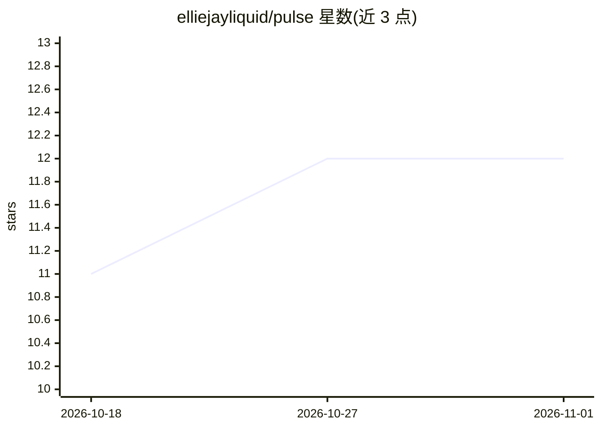

# elliejayliquid/pulse

⭐ 12 · Python · MIT · 推送 2026-09-07 · [GitHub](https://github.com/elliejayliquid/pulse) · 个人维护

**本地/云端 AI 陪伴对象的常驻守护进程，经 Telegram 对话**

面向终端用户的后台守护进程，为 AI 陪伴角色提供周期性自主思考（心跳循环）、Telegram 双向聊天与工具调用、基于 SQLite 的持久记忆与语义检索、日记、自排程提醒、语音转写（本地 whisper.cpp）、语音合成（Qwen3-TTS）、文档阅读与 MCP 服务器接入。模型侧支持本地 llama.cpp 管理 llama-server，或切换 OpenAI/OpenRouter/Anthropic/AWS Bedrock 等云端 API；支持多 persona 各自独立模型与数据。README 自述处于活跃开发期，核心可用但存在粗糙边缘；Telegram 目前为必需渠道。

## 筛选速览

| 维度 | 判定 | 备注 |
|---|---|---|
| AI 角色 | `ai-native` | 本体是模型或模型工具 |
| 许可风险 | `permissive` | MIT |
| 部署形态 | `desktop` | 安装包/桌面程序 |
| 模型依赖 | local-ok | 支持本地模型 |
| 硬件要求 | `cpu-ok` | |
| 安装摩擦 | `medium` | 含编译或系统依赖之一 |
| 成熟度 | `idea` | |

## 能力要点

- 心跳循环让陪伴对象自主决定联系、沉默、写日记或排程
- per-persona SQLite 数据库存储记忆/日记/任务，支持语义检索
- 本地 llama.cpp 自动管理 llama-server，或切换云端 API
- 本地 whisper.cpp 语音转写与 Qwen3-TTS 语音回复

## 适用场景

- 让 AI 陪伴角色在 Telegram 上主动保持联系并记住对话
- 导入 ChatGPT/Claude 等历史对话供陪伴对象检索引用
- 本地 GGUF 模型离线运行或按 persona 切换不同云端模型

## 场景标签

`聊天机器人` · 领域:对话与助手

## 证据(README 行号)

> L5: Pulse gives your AI companion a life of their own. It runs in the background, letting your companion think on their 
> L13: - **Heartbeat loop** — Your companion gets periodic "free-think" ticks where they can decide to reach out, stay qui
> L14: - **Telegram chat** — Bidirectional messaging with tool use (your companion can save memories, set reminders, searc

## 星数曲线

2026-10-18 11 → 2026-11-01 12（+1）

---
*卡片 v1 · prompt 1.4 · 生成 2026-11-01 · 置信度 mid · 依据 README sha `e2814e8cc49b` · [字段定义](../../DATASET.md)*
