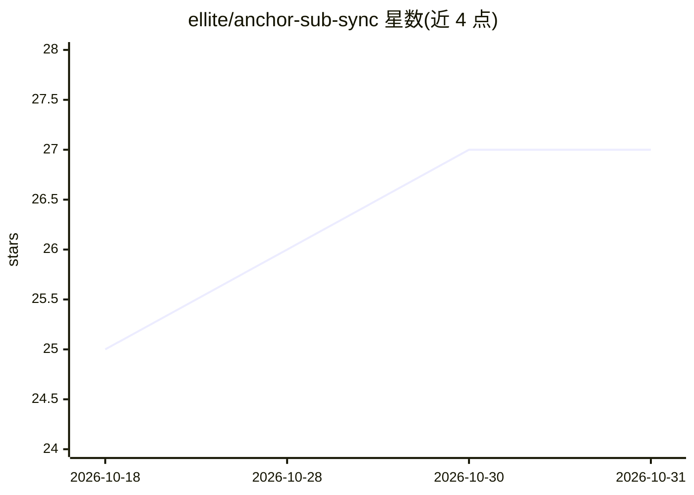

# ellite/anchor-sub-sync

⭐ 27 · Python · AGPL-3.0 · 推送 2026-10-09 · [GitHub](https://github.com/ellite/anchor-sub-sync) · [官网](https://anchor.henrique.pt) · 个人维护

**GPU 加速的字幕同步与翻译 CLI，基于 Whisper 语音对齐**

Anchor 是一个 Python 命令行工具，通过 WhisperX（或可选的 NVIDIA Parakeet）听取视频音轨，对 .srt/.ass 字幕做音素级对齐、全局词匹配与漂移校正，实现毫秒级字幕同步；另提供基于 NLLB 的上下文感知翻译、直接转录生成字幕、容器封装/烧录、格式转换、字幕下载等功能，并可作为本地翻译 API 服务器与 Subtitle Edit 集成。支持跨语言同步（先生成临时翻译再对齐回写时间轴）。需 Python 3.10/3.11 与 ffmpeg，GPU 推荐、CPU 亦可运行。

## 筛选速览

| 维度 | 判定 | 备注 |
|---|---|---|
| AI 角色 | `ai-native` | 本体是模型或模型工具 |
| 许可风险 | `viral` | AGPL-3.0 |
| 部署形态 | `library` | 以包/库形式分发 |
| 模型依赖 | — | README 未给出锁定关系 |
| 硬件要求 | — | 无带数字的原话,不猜 |
| 安装摩擦 | `medium` | 含编译或系统依赖之一 |
| 成熟度 | — | 结构信号不足 |

## 能力要点

- WhisperX 音素级对齐 + 漂移校正实现毫秒级字幕同步
- NLLB 上下文感知翻译，保留双人对话与自动格式化
- 本地 API 服务器模式，兼容 Subtitle Edit Auto-Translate
- 跨语言同步：音频与字幕语言不同时经临时翻译对齐回写时间轴

## 适用场景

- 把不同帧率或漂移的字幕自动对齐到视频
- 整季剧集用一个精准参考字幕批量同步
- 直接从视频生成字幕或做跨语言字幕翻译
- 为 Subtitle Edit 提供本地 NLLB 翻译后端

## 场景标签

`语音识别` · 领域:感知与多模态

## 证据(README 行号)

> L13: **Anchor** is a GPU-accelerated tool that automatically synchronizes subtitle files (.srt, .ass) to video files usi
> L22: - 🌐 **Translation**: Context-aware translation using NLLB, with dual-speaker preservation and auto-formatting.

## 星数曲线

2026-10-18 25 → 2026-10-31 27（+2）

---
*卡片 v1 · prompt 1.4 · 生成 2026-10-27 · 置信度 high · 依据 README sha `02f6d53dcb58` · [字段定义](../../DATASET.md)*
