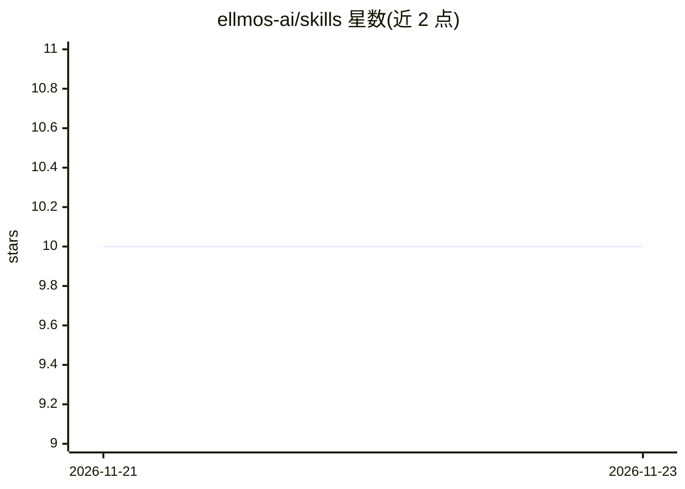

# ellmos-ai/skills

⭐ 10 · Python · MIT · 推送 2026-11-22 · [GitHub](https://github.com/ellmos-ai/skills) · [官网](https://github.com/ellmos-ai/skills#readme) · 组织维护

**面向 Claude Code 类 agent 的可移植 SKILL.md 技能库**

ellmos 生态的可复用技能目录，收录 142 个公开技能（跟踪 380 个），以 Anthropic 兼容的 SKILL.md 格式组织，每个技能在 YAML frontmatter 中携带元数据，无需中央注册表即可检查来源、兼容性与依赖。按 assist/dev/education/infrastructure 等类别分发，支持零外发（Zero-Egress）本地优先运行，提供机器可读目录 components.json 与 llms.txt，配套 455 项 Pytest 测试与 S/L/U 三级测试框架。

## 筛选速览

| 维度 | 判定 | 备注 |
|---|---|---|
| AI 角色 | `ai-knowledge` | 知识聚合/清单类 |
| 许可风险 | `permissive` | MIT |
| 部署形态 | `None` |  |
| 模型依赖 | — | README 未给出锁定关系 |
| 硬件要求 | — | 无带数字的原话,不猜 |
| 安装摩擦 | `low` | 无编译、无系统依赖或容器化 |
| 成熟度 | — | 结构信号不足 |

## 能力要点

- 142 个公开技能按 8 类组织，SKILL.md + YAML frontmatter 标准格式
- 零外发（Zero-Egress）隐私边界与静态隐私门控测试
- 提供 registry/components.json 机器可读目录与 llms.txt
- 455 项 Pytest 测试与三层 S/L/U 技能测试框架

## 适用场景

- 为 Claude Code、Codex 等本地 agent 运行时挂载现成技能
- 隔离环境中零遥测的本地优先 agent 工作流
- 为自定义技能查找格式规范与测试工具
- DevOps 平台团队复用基础设施与开发流程 playbook

## 场景标签

`Agent 框架` `精选清单` · 领域:Agent 开发

## 证据(README 行号)

> L28: Public Skills: 142 Catalog
> L48: This repository is the reusable skill catalog of the ellmos ecosystem. It contains standalone process skills, devel
> L36: > **AI Agent & LLM Integration:** This repository provides standardized `SKILL.md` files with YAML frontmatter that

## 星数曲线

2026-11-21 10 → 2026-11-23 10（+0）

---
*卡片 v1 · prompt 1.4 · 生成 2026-11-21 · 置信度 high · 依据 README sha `69183f8e6158` · [字段定义](../../DATASET.md)*
