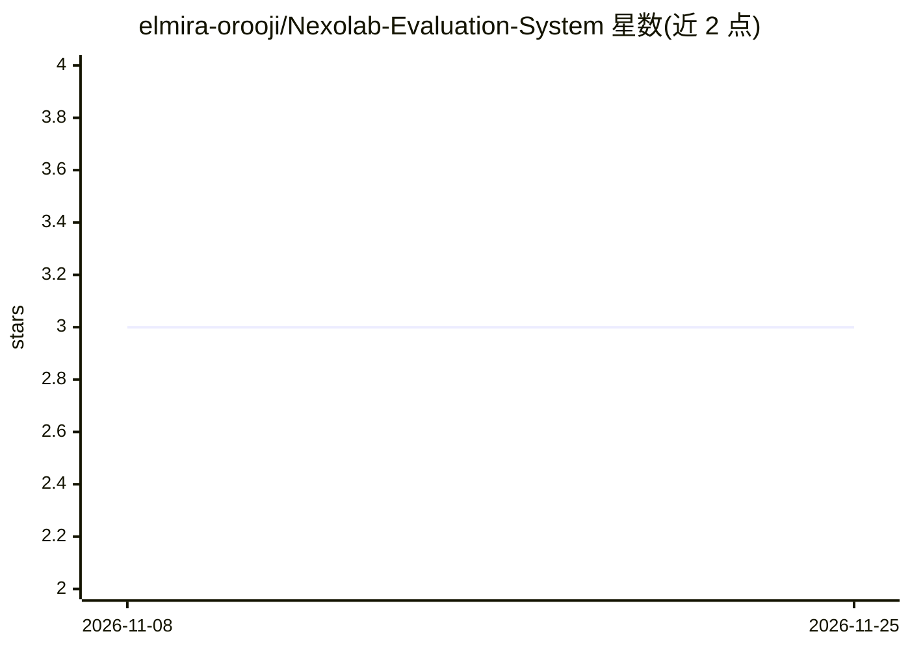

# elmira-orooji/Nexolab-Evaluation-System

⭐ 3 · TypeScript · 推送 2026-11-09 · [GitHub](https://github.com/elmira-orooji/Nexolab-Evaluation-System) · 个人维护

**面向波斯语 RAG 系统的本地评测工作台**

针对波斯语 RAG 系统的本地评测工作台：对已接入的 RAG API 运行版本化测试套件，存储回答、来源、引用、延迟与配置快照，计算确定性的文档召回与引用精确率/召回率/F1，并提供 JSON/CSV/Markdown 报告、运行对比与人工评审页面。采用 ports-and-adapters 架构，通过 CLI 与本地 Web 界面（仅绑定 127.0.0.1）使用；内置 fixture 适配器只演练流程，不度量真实系统质量；语义判定（DeepEval）为可选 extra，需显式启用并会产生外部 API 调用。

## 筛选速览

| 维度 | 判定 | 备注 |
|---|---|---|
| AI 角色 | `ai-ecosystem` | LLM/agent 周边工具 |
| 许可风险 | `none` | — |
| 部署形态 | `library` | 以包/库形式分发 |
| 模型依赖 | — | README 未给出锁定关系 |
| 硬件要求 | — | 无带数字的原话,不猜 |
| 安装摩擦 | `low` | 无编译、无系统依赖或容器化 |
| 成熟度 | — | 结构信号不足 |

## 能力要点

- 基于预期文档 ID 的确定性引用指标（precision/recall/F1）
- 每次运行保存测试套件与配置快照，含 SHA-256 指纹的可复现报告
- 运行对比页面与 /api/compare 结构化对比接口
- 1–4 分维度的人工评审，评审记录与报告分离存储

## 适用场景

- 为波斯语 RAG 系统跑可复现的回归评测
- 在 Web 界面人工打分回答正确性与引用质量
- 对比两次运行定位回答与来源的变化

## 场景标签

`模型评测` `RAG` · 领域:评测与运维

## 证据(README 行号)

> L7: NexoLab is a Persian-first evaluation workspace for Retrieval-Augmented Generation (RAG) systems. It runs a test sui
> L18: - Calculate deterministic document-recall and citation precision, recall, and F1 metrics when expected document IDs

## 星数曲线

2026-11-08 3 → 2026-11-25 3（+0）

---
*卡片 v1 · prompt 1.4 · 生成 2026-11-22 · 置信度 high · 依据 README sha `164c0ee63118` · [字段定义](../../DATASET.md)*
