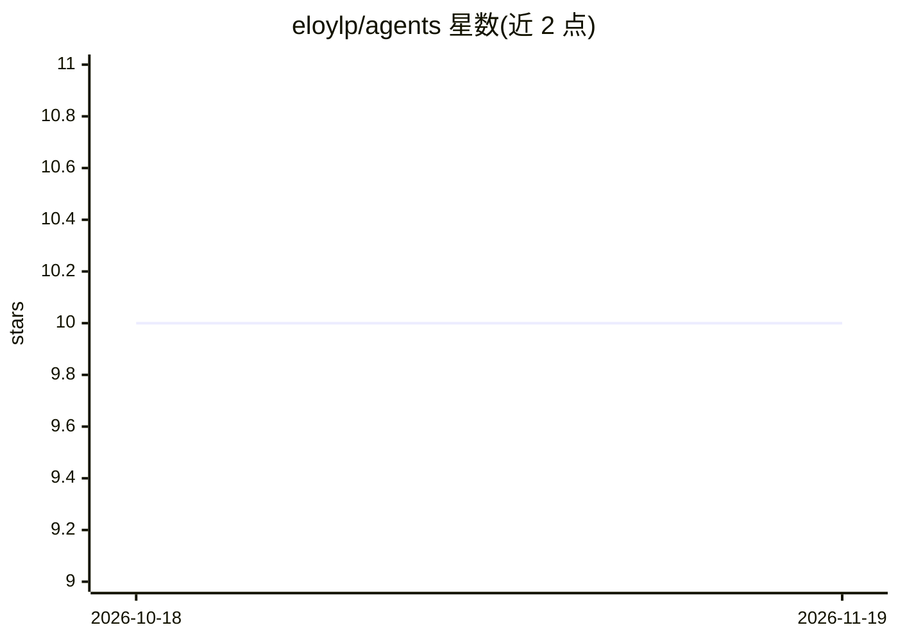

# eloylp/agents

⭐ 10 · Go · MIT · 推送 2026-08-29 · [GitHub](https://github.com/eloylp/agents) · 个人维护

**自托管多 agent 仓库工作流编排守护进程**

用 Go 编写的自托管守护进程，在用户自己的仓库上编排多 agent 工作流：以技能、记忆和触发器（仓库事件/标签、cron、agent 间调度）组合 agent，在一次性 runner 容器内运行 AI CLI（Claude Code、Codex 或本地模型），并通过 issues/PR/review 等仓库原生原语工作。提供 Web 仪表盘、MCP server 与 REST API 三种接口，含 token 预算、运行追踪与 prompt 注入防护等护栏。当前支持 GitHub，GitLab 在讨论中；安全责任由运营者承担。

## 筛选速览

| 维度 | 判定 | 备注 |
|---|---|---|
| AI 角色 | `ai-ecosystem` | LLM/agent 周边工具 |
| 许可风险 | `permissive` | MIT |
| 部署形态 | `None` |  |
| 模型依赖 | — | README 未给出锁定关系 |
| 硬件要求 | — | 无带数字的原话,不猜 |
| 安装摩擦 | `low` | 无编译、无系统依赖或容器化 |
| 成熟度 | — | 结构信号不足 |

## 能力要点

- 三种接口：Web 图形化工作流设计器、MCP server、REST API
- 每次运行在一次性 runner 容器内执行 AI CLI 并保留完整事件链与 trace
- 多后端：同一 fleet 中每个 agent 可选 Claude、Codex 或本地模型
- SQLite 单文件状态，无外部运行时依赖

## 适用场景

- 让多个 agent 自动处理仓库的 issue、PR 评审与标签事件
- 通过 cron 或 webhook 定时/按事件触发 agent 任务
- 在本地模型上运行代码评审类 agent 而代码不出自建基础设施
- 用 token 预算与用量排行管理 agent 消耗

## 场景标签

`多智能体` `工作流自动化` `代码审查` · 领域:Agent 开发

## 证据(README 行号)

> L10: **A self-hosted, observable agent orchestrator for running multi-agent workflows on your repos.**
> L14: The daemon schedules each agent and runs the AI CLI (Claude Code, Codex, or your own local LLM) inside a fresh ephe
> L37: - **Multi-backend**: pick Claude, Codex, or a local model per agent; different agents in the same fleet can use dif

## 星数曲线

2026-10-18 10 → 2026-11-19 10（+0）

---
*卡片 v1 · prompt 1.4 · 生成 2026-11-19 · 置信度 high · 依据 README sha `dd7bf18c2b9c` · [字段定义](../../DATASET.md)*
