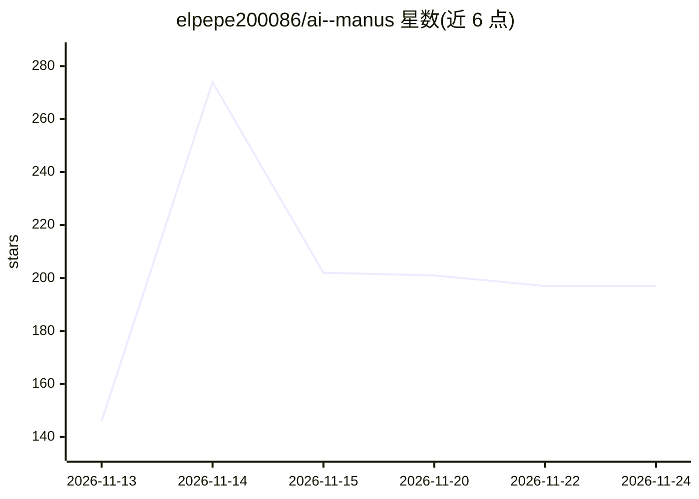

# elpepe200086/ai--manus

⭐ 193 · Apache-2.0 · 推送 2026-11-13 · [GitHub](https://github.com/elpepe200086/ai--manus) · 个人维护

**面向日常小任务的自主 AI Agent：代为执行代码与浏览器操作**

README 描述其为一个自主 AI Agent，能够在用户授权下执行脚本与浏览器操作（导航网页、填写表单、多步任务），定位为家庭、学习与轻办公场景的个人助手，而非企业平台。文档给出硬件兼容表（最低双核 CPU、4 GB 内存）与六步使用流程（准备、配置、测试、细化、应用、维护）。但 README 未提供任何安装命令、技术栈、模型接入方式或代码结构说明，仅含'Download Manus / PROMO2026'字样与大量搜索词堆砌，实际可用性无法从文档验证。

## 筛选速览

| 维度 | 判定 | 备注 |
|---|---|---|
| AI 角色 | `ai-native` | 本体是模型或模型工具 |
| 许可风险 | `permissive` | Apache-2.0 |
| 部署形态 | `None` |  |
| 模型依赖 | — | README 未给出锁定关系 |
| 硬件要求 | — | 无带数字的原话,不猜 |
| 安装摩擦 | `low` | 无编译、无系统依赖或容器化 |
| 成熟度 | — | 结构信号不足 |

## 能力要点

- 自主执行代码与浏览器操作的多步任务
- 声明面向家庭、学习与轻办公的小规模场景
- 文档给出最低/推荐硬件兼容表

## 适用场景

- 希望由 AI 代为完成重复性的脚本与网页操作
- 学习中整理研究资料与快速计算
- 远程工作者从多页面收集信息并汇总

## 场景标签

`AI 助手` `浏览器自动化` · 领域:效率与自动化

## 证据(README 行号)

> L10: - **Autonomous Code Execution:** Manus AI agent runs code on its own to complete tasks, so you can focus on decisio
> L18: Manus is an autonomous AI agent designed to run code and control a browser on your behalf. Instead of acting like a

## 星数曲线

2026-11-13 146 → 2026-11-24 197（+51）

---
*卡片 v1 · prompt 1.4 · 生成 2026-11-17 · 置信度 low · 依据 README sha `66ba5de9af15` · [字段定义](../../DATASET.md)*
