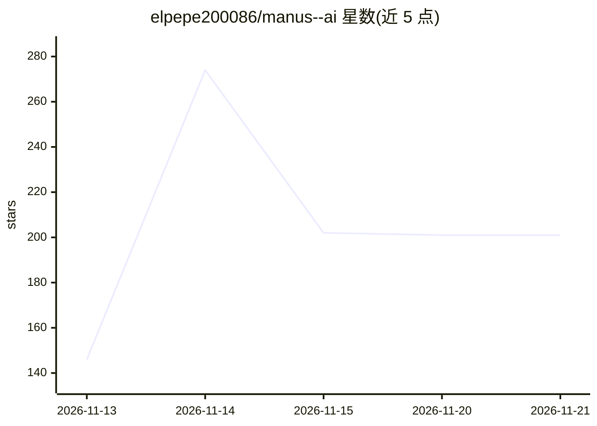

# elpepe200086/manus--ai

⭐ 201 · Apache-2.0 · 推送 2026-11-13 · [GitHub](https://github.com/elpepe200086/manus--ai) · 个人维护

**面向个人用户的自主 AI Agent：自动执行代码与浏览器操作**

README 描述 Manus 为自主 AI 代理，可在用户授意下编写并执行脚本、控制浏览器完成表单填写、网页信息收集等多步骤任务，定位为学习、家庭与轻量办公场景的后台个人助理。声明支持跨会话记忆工作流模式。README 仅给出兼容性表（最低双核 CPU、4GB 内存）与使用流程说明，未提供可验证的安装命令、下载渠道细节或技术架构描述。

## 筛选速览

| 维度 | 判定 | 备注 |
|---|---|---|
| AI 角色 | `ai-native` | 本体是模型或模型工具 |
| 许可风险 | `permissive` | Apache-2.0 |
| 部署形态 | `None` |  |
| 模型依赖 | — | README 未给出锁定关系 |
| 硬件要求 | — | 无带数字的原话,不猜 |
| 安装摩擦 | `low` | 无编译、无系统依赖或容器化 |
| 成熟度 | — | 结构信号不足 |

## 能力要点

- 自主代码执行：agent 自行编写并运行脚本完成任务
- 浏览器控制：导航网页、填写表单、收集信息
- 多步骤任务可在脚本与浏览器操作间衔接
- 跨会话记住工作流模式并重复应用

## 适用场景

- 让 agent 代为执行重复性的代码运行与网页查资料任务
- 学生整理研究笔记、跑小型计算
- 轻量办公中从多个页面汇总信息

## 场景标签

`AI 助手` `浏览器自动化` `编码 Agent` · 领域:效率与自动化

## 证据(README 行号)

> L10: - **Autonomous Code Execution:** Manus AI agent runs code on its own to complete tasks, so you can focus on decisio
> L18: Manus is an autonomous AI agent designed to run code and control a browser on your behalf. Instead of acting like a

## 星数曲线

2026-11-13 146 → 2026-11-21 201（+55）

---
*卡片 v1 · prompt 1.4 · 生成 2026-11-17 · 置信度 low · 依据 README sha `66ba5de9af15` · [字段定义](../../DATASET.md)*
