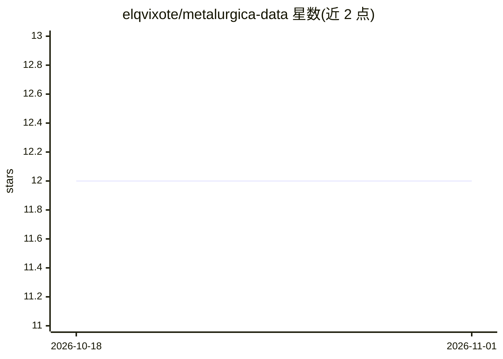

# elqvixote/metalurgica-data

⭐ 12 · Jupyter Notebook · NOASSERTION · 推送 2026-05-02 · [GitHub](https://github.com/elqvixote/metalurgica-data) · 个人维护

**冶金与采矿工艺开放数据集库，供数据分析与机器学习**

面向学生、工程师、教师和数据科学家的开放协作数据库：收录浮选、熔炼、炼钢、焊接、力学试验等冶金工艺的合成、匿名化或官方数据集（含秘鲁矿业生产数据 MINEM 2021–2025）。多数数据集为基于真实操作范围生成的合成数据，每个文件附变量与单位说明。用途包括回归/分类/聚类、Power BI 或 Python 仪表板、教学与论文；数据集采用 CC BY 4.0，代码 MIT。支持通过 issue 或上传新数据集贡献。

## 筛选速览

| 维度 | 判定 | 备注 |
|---|---|---|
| AI 角色 | `ai-knowledge` | 知识聚合/清单类 |
| 许可风险 | `none` | NOASSERTION |
| 部署形态 | `None` |  |
| 模型依赖 | — | README 未给出锁定关系 |
| 硬件要求 | — | 无带数字的原话,不猜 |
| 安装摩擦 | `low` | 无编译、无系统依赖或容器化 |
| 成熟度 | — | 结构信号不足 |

## 能力要点

- 覆盖浮选、熔炼、炼钢、焊接、热处理等工艺数据集
- 包含秘鲁矿业生产官方数据（MINEM 2021–2025）
- 数据集逐文件标注变量描述与单位
- 数据 CC BY 4.0、代码 MIT 双许可文件

## 适用场景

- 用冶金工艺数据练习回归、分类或聚类建模
- 为课程、工作坊或毕业论文找教学数据集
- 用 Power BI 或 Python 构建工艺监控仪表板

## 场景标签

 · 领域:冶金/采矿数据科学

## 证据(README 行号)

> L2: **Metalúrgica Data** es una iniciativa abierta y colaborativa que busca construir una base de datos pública con info
> L26: - **Sintéticos realistas**: generados a partir de rangos técnicos reales de operación

## 星数曲线

2026-10-18 12 → 2026-11-01 12（+0）

---
*卡片 v1 · prompt 1.4 · 生成 2026-11-01 · 置信度 high · 依据 README sha `67fd81633b03` · [字段定义](../../DATASET.md)*
