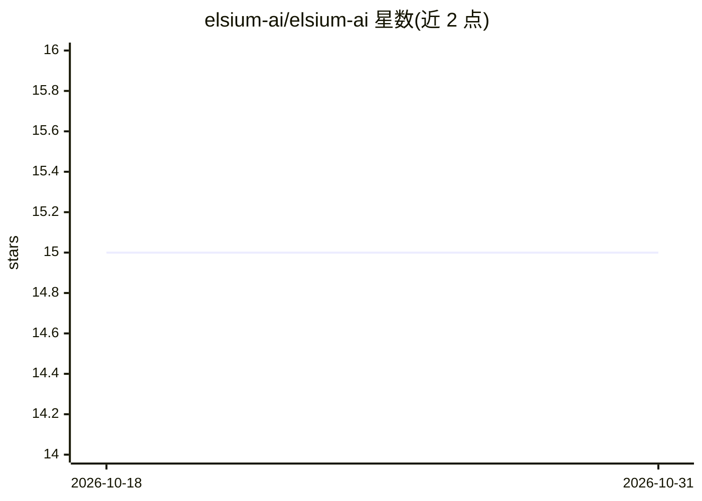

# elsium-ai/elsium-ai

⭐ 15 · TypeScript · MIT · 推送 2026-08-31 · [GitHub](https://github.com/elsium-ai/elsium-ai) · [官网](https://elsiumai.com/) · 组织维护

**面向生产环境的 TypeScript AI 运行时框架，主打可靠性与治理**

TypeScript AI 框架，围绕三大支柱组织：可靠性（熔断器、并发隔离、请求去重、优雅停机、流故障转移）、治理（声明式策略引擎、RBAC、多级审批链、SHA-256 哈希链审计日志、PII 检测、合规报告、AI-BOM）、可复现性（seed 传播、输出锁定、漂移检测、签名重放）。另提供多提供商网关、Agent、RAG、工作流、MCP 桥接、成本追踪等基础能力。支持 Node/Bun/Deno/Cloudflare Workers 等多运行时，通过 npm 安装。README 明确声明框架自身无法使托管模型完全确定论，需配合 mockProvider 或重放夹具。

## 筛选速览

| 维度 | 判定 | 备注 |
|---|---|---|
| AI 角色 | `ai-ecosystem` | LLM/agent 周边工具 |
| 许可风险 | `permissive` | MIT |
| 部署形态 | `library` | 以包/库形式分发 |
| 模型依赖 | local-ok | 支持本地模型 |
| 硬件要求 | — | 无带数字的原话,不猜 |
| 安装摩擦 | `low` | 无编译、无系统依赖或容器化 |
| 成熟度 | — | 结构信号不足 |

## 能力要点

- 熔断器、并发隔离、按 Agent 公平排队等可靠性原语
- 声明式策略引擎 + RBAC + 哈希链审计日志 + 合规报告（OWASP/EU AI Act）
- seed 传播、输出锁定、漂移检测、审计级签名重放
- 多提供商网关与 OpenAI 兼容适配器（可接 Ollama/Groq 等）

## 适用场景

- 生产环境 LLM 系统的治理与审计合规
- 多提供商接入的网关与故障切换
- 通过重放与漂移检测保障 AI 输出可复现
- Agent 工作流的策略管控与审批

## 场景标签

`Agent 框架` `模型网关` `LLM 可观测性` · 领域:Agent 开发

## 证据(README 行号)

> L43: It also does everything you'd expect — multi-provider gateway, agents, tools, RAG, workflows, MCP, streaming, cost 
> L158: - **Multi-provider gateway** — X-Ray mode, middleware, smart routing (fallback, cost-optimized, latency-racing, ca

## 星数曲线

2026-10-18 15 → 2026-10-31 15（+0）

---
*卡片 v1 · prompt 1.4 · 生成 2026-10-30 · 置信度 high · 依据 README sha `8e806e528f86` · [字段定义](../../DATASET.md)*
