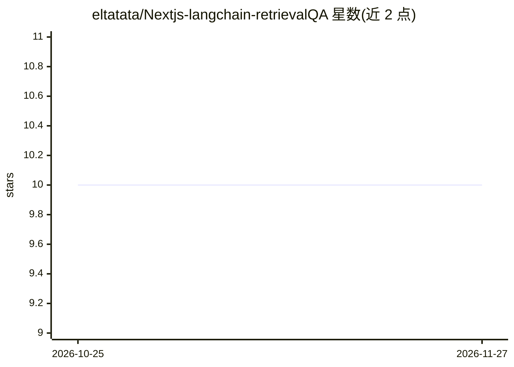

# eltatata/Nextjs-langchain-retrievalQA

⭐ 10 · TypeScript · 推送 2026-01-23 · [GitHub](https://github.com/eltatata/Nextjs-langchain-retrievalQA) · [官网](https://nextjs-langchain-retrieval-qa.vercel.app) · 个人维护

**基于 PDF 语料的数据结构问答聊天机器人**

一个以 Next.js 与 Vercel AI SDK 构建的聊天机器人，使用 LangChain 的 RetrievalQA 管道：将一份关于数据结构的 PDF 载入 MongoDB 向量存储，用户以自然语言提问时检索相关片段并生成回答。所有回答内容基于该 PDF 来源。仓库含演示视频、PDF 下载链接与技术栈说明，通过 git clone 获取源码后安装运行。

## 筛选速览

| 维度 | 判定 | 备注 |
|---|---|---|
| AI 角色 | `ai-native` | 本体是模型或模型工具 |
| 许可风险 | `none` | — |
| 部署形态 | `None` |  |
| 模型依赖 | — | README 未给出锁定关系 |
| 硬件要求 | — | 无带数字的原话,不猜 |
| 安装摩擦 | `low` | 无编译、无系统依赖或容器化 |
| 成熟度 | — | 结构信号不足 |

## 能力要点

- RAG 流程：PDF 来源 + MongoDB 向量存储 + RetrievalQA
- 自然语言提问并返回基于来源的回答
- Next.js 与 Vercel AI SDK 前端集成

## 适用场景

- 就数据结构课程内容向 AI 提问获取出处说明
- 参考该实现搭建自己的单文档 RAG 聊天机器人

## 场景标签

`聊天机器人` `RAG` `文档问答` · 领域:对话与助手

## 证据(README 行号)

> L5: **Felipe** is a lightweight AI assistant built with RAG (Retrieval-Augmented Generation) to help users ask questions
> L11: - ⚙️ Built using **LangChain**, **Next.js**, and **Vercel AI SDK**.
> L12: - 🧠 **MongoDB** is used as the vector store for efficient semantic search.

## 星数曲线

2026-10-25 10 → 2026-11-27 10（+0）

---
*卡片 v1 · prompt 1.4 · 生成 2026-11-19 · 置信度 high · 依据 README sha `c73d268b0d8c` · [字段定义](../../DATASET.md)*
