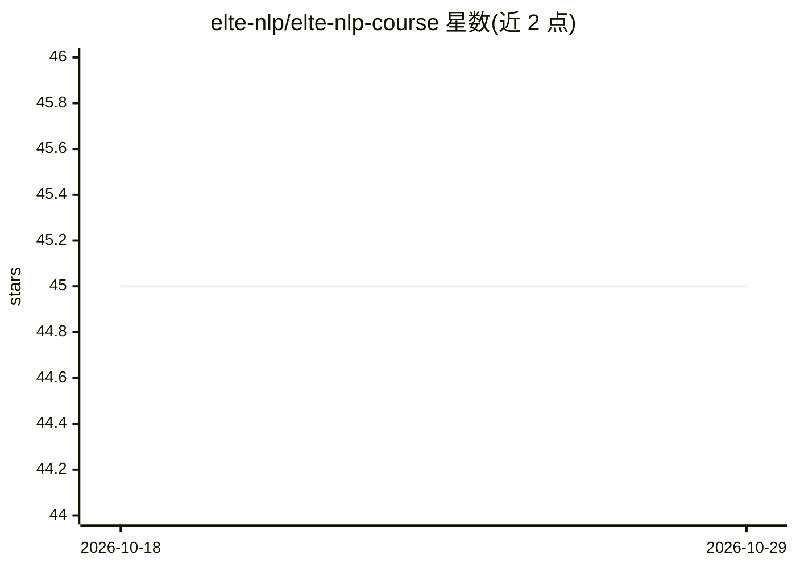

# elte-nlp/elte-nlp-course

⭐ 45 · Jupyter Notebook · CC-BY-4.0 · 推送 2026-10-17 · [GitHub](https://github.com/elte-nlp/elte-nlp-course) · [官网](https://drive.google.com/drive/u/1/folders/1S_WgFtfvz-Tw1a7TMupgg0s2GoO_0ZHv) · 组织维护

**ELTE 大学 NLP 与基础模型课程的讲义幻灯片**

Eötvös Loránd 大学《自然语言处理与语言基础模型》课程（IPM-23fmiNLPFMEG）的讲义幻灯片仓库，以 PDF 形式发布于 Google Drive，仓库内提供学生文献研究项目展示与 practice_examples 实践材料文件夹（含推理端点信息）。材料按 CC-BY-4.0 许可发布，附 BibTeX 引用格式，供教学与自学者复用。

## 筛选速览

| 维度 | 判定 | 备注 |
|---|---|---|
| AI 角色 | `ai-knowledge` | 知识聚合/清单类 |
| 许可风险 | `viral` | CC-BY-4.0 |
| 部署形态 | `None` |  |
| 模型依赖 | — | README 未给出锁定关系 |
| 硬件要求 | — | 无带数字的原话,不猜 |
| 安装摩擦 | `low` | 无编译、无系统依赖或容器化 |
| 成熟度 | — | 结构信号不足 |

## 能力要点

- NLP 与语言基础模型课程的完整讲义幻灯片（PDF）
- 附学生文献研究项目展示与实践材料文件夹
- CC-BY-4.0 许可，提供 BibTeX 引用格式

## 适用场景

- 系统学习 NLP 与基础模型的课程内容
- 查找学生文献研究项目示例
- 以 CC-BY 许可复用教学材料

## 场景标签

`教程课程` · 领域:学习与行业

## 证据(README 行号)

> L1: # Lecture slides for Eötvös Loránd University's Natural Language Processing and Language-based Foundation Models (*I
> L3: The latest PDF versions of the slides can be found in this Google Drive folder.

## 星数曲线

2026-10-18 45 → 2026-10-29 45（+0）

---
*卡片 v1 · prompt 1.4 · 生成 2026-10-25 · 置信度 high · 依据 README sha `5e39b5ca88ef` · [字段定义](../../DATASET.md)*
