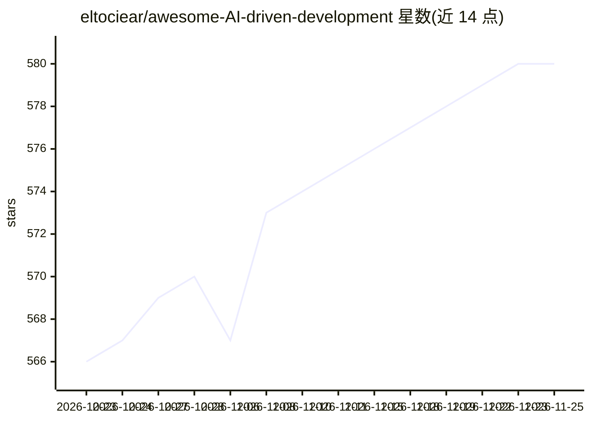

# eltociear/awesome-AI-driven-development

⭐ 580 · 推送 2026-11-19 · [GitHub](https://github.com/eltociear/awesome-AI-driven-development) · 个人维护

**AI 驱动开发工具的策展清单（609 项）**

收录 AI 驱动开发相关工具、框架与资源的 awesome 清单，当前收录 609 个工具。按 AI 代码编辑器与 IDE、终端与 CLI Agent、IDE 扩展等类别组织条目，每条附一句官方描述；条目覆盖代码编辑器、终端编码 Agent、VS Code 扩展等形态。灵感来自 AI 駆動開発，内容持续收录与分类，本身不提供可运行软件。

## 筛选速览

| 维度 | 判定 | 备注 |
|---|---|---|
| AI 角色 | `ai-knowledge` | 知识聚合/清单类 |
| 许可风险 | `none` | — |
| 部署形态 | `library` | 以包/库形式分发 |
| 模型依赖 | — | README 未给出锁定关系 |
| 硬件要求 | — | 无带数字的原话,不猜 |
| 安装摩擦 | `low` | 无编译、无系统依赖或容器化 |
| 成熟度 | — | 结构信号不足 |

## 能力要点

- 收录 609 个 AI 开发工具与资源
- 按编辑器/终端 Agent/IDE 扩展等类别组织
- 覆盖 Claude Code、Codex CLI、Gemini CLI 等终端 Agent 条目

## 适用场景

- 查找可替代商业产品的开源 AI 编码工具
- 按类别浏览终端 CLI Agent 与 IDE 扩展生态
- 调研 AI 驱动开发工具的收录情况

## 场景标签

`精选清单` `编码 Agent` `代码生成` · 领域:编码与开发

## 证据(README 行号)

> L6: A curated list of awesome AI-Driven development tools, frameworks, and resources. Currently featuring **609 tools** 
> L10: ## AI Code Editors & IDEs

## 星数曲线

2026-10-23 566 → 2026-11-25 580（+14）

---
*卡片 v1 · prompt 1.4 · 生成 2026-11-25 · 置信度 mid · 依据 README sha `5670e5d0dbef` · [字段定义](../../DATASET.md)*
