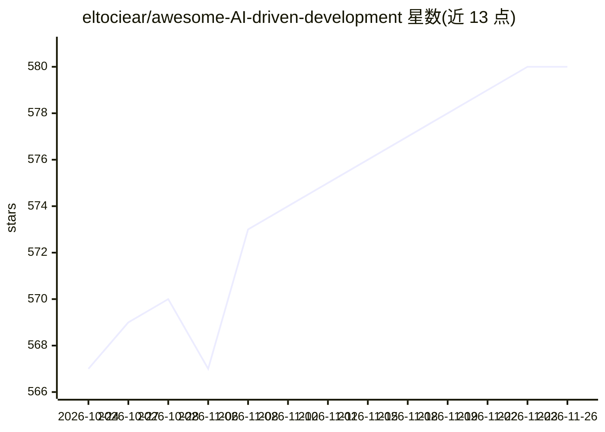

# eltociear/awesome-AI-driven-development

⭐ 580 · 推送 2026-11-25 · [GitHub](https://github.com/eltociear/awesome-AI-driven-development) · 个人维护

**AI 驱动开发工具与资源的策展清单（611 个条目）**

一份 awesome 类清单，收录 AI 驱动开发相关的工具、框架与资源，当前收录 611 个工具。按类别组织，包括 AI 代码编辑器与 IDE、终端/CLI 编码 Agent、IDE 扩展等板块；每条为一句话描述与仓库链接，灵感来源为日文的 AI駆動開発。清单本身不提供软件安装或运行方式，用途是浏览与发现 AI 开发工具；条目描述中涉及 Claude Code、Gemini、Codex 等具体产品。

## 筛选速览

| 维度 | 判定 | 备注 |
|---|---|---|
| AI 角色 | `ai-knowledge` | 知识聚合/清单类 |
| 许可风险 | `none` | — |
| 部署形态 | `library` | 以包/库形式分发 |
| 模型依赖 | — | README 未给出锁定关系 |
| 硬件要求 | — | 无带数字的原话,不猜 |
| 安装摩擦 | `low` | 无编译、无系统依赖或容器化 |
| 成熟度 | — | 结构信号不足 |

## 能力要点

- 收录 611 个 AI 驱动开发工具条目
- 按代码编辑器/IDE、终端 CLI Agent、IDE 扩展等类别组织
- 覆盖 spec-driven development 等主题的整理

## 适用场景

- 查找可用的 AI 编码编辑器与 CLI Agent 工具
- 浏览 AI 开发工具生态的分类概览
- 为工具选型收集候选清单

## 场景标签

`精选清单` · 领域:学习与行业

## 证据(README 行号)

> L4: # 🤖 Awesome AI-Driven Development
> L8: A curated list of awesome AI-Driven development tools, frameworks, and resources. Currently featuring **611 tools** 
> L12: ## AI Code Editors & IDEs

## 星数曲线

2026-10-24 567 → 2026-11-26 580（+13）

---
*卡片 v1 · prompt 1.4 · 生成 2026-11-26 · 置信度 mid · 依据 README sha `3b0135671181` · [字段定义](../../DATASET.md)*
