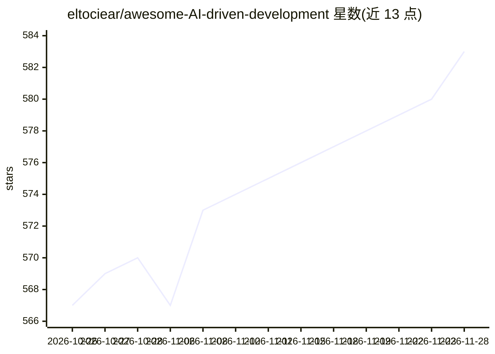

# eltociear/awesome-AI-driven-development

⭐ 583 · 推送 2026-11-27 · [GitHub](https://github.com/eltociear/awesome-AI-driven-development) · 个人维护

**AI 驱动开发工具/框架/资源策展清单（612 条）**

一个 awesome 格式的 AI 驱动开发资源清单，收录 612 个工具，按 AI 代码编辑器与 IDE、终端/CLI Agent、IDE 扩展等章节组织，条目为一句话描述加仓库链接。灵感来自 AI 驱动开发理念，不包含安装说明或使用文档，仅提供目录导航；页首预告了相关线上峰会与直播。

## 筛选速览

| 维度 | 判定 | 备注 |
|---|---|---|
| AI 角色 | `ai-knowledge` | 知识聚合/清单类 |
| 许可风险 | `none` | — |
| 部署形态 | `library` | 以包/库形式分发 |
| 模型依赖 | — | README 未给出锁定关系 |
| 硬件要求 | — | 无带数字的原话,不猜 |
| 安装摩擦 | `low` | 无编译、无系统依赖或容器化 |
| 成熟度 | — | 结构信号不足 |

## 能力要点

- 收录 612 个 AI 驱动开发工具与资源
- 按代码编辑器、终端 Agent、IDE 扩展等类别组织
- 覆盖 spec-driven development 与代码生成主题

## 适用场景

- 为团队挑选 AI 编码编辑器或终端 Agent 时浏览候选
- 了解 AI 驱动开发生态中各类工具的分布
- 寻找 VS Code 的 AI 编码助手扩展

## 场景标签

`精选清单` · 领域:学习与行业

## 证据(README 行号)

> L8: A curated list of awesome AI-Driven development tools, frameworks, and resources. Currently featuring **612 tools** 
> L10: ## Contents

## 星数曲线

2026-10-26 567 → 2026-11-28 583（+16）

---
*卡片 v1 · prompt 1.4 · 生成 2026-11-28 · 置信度 mid · 依据 README sha `252bec1d5ef6` · [字段定义](../../DATASET.md)*
