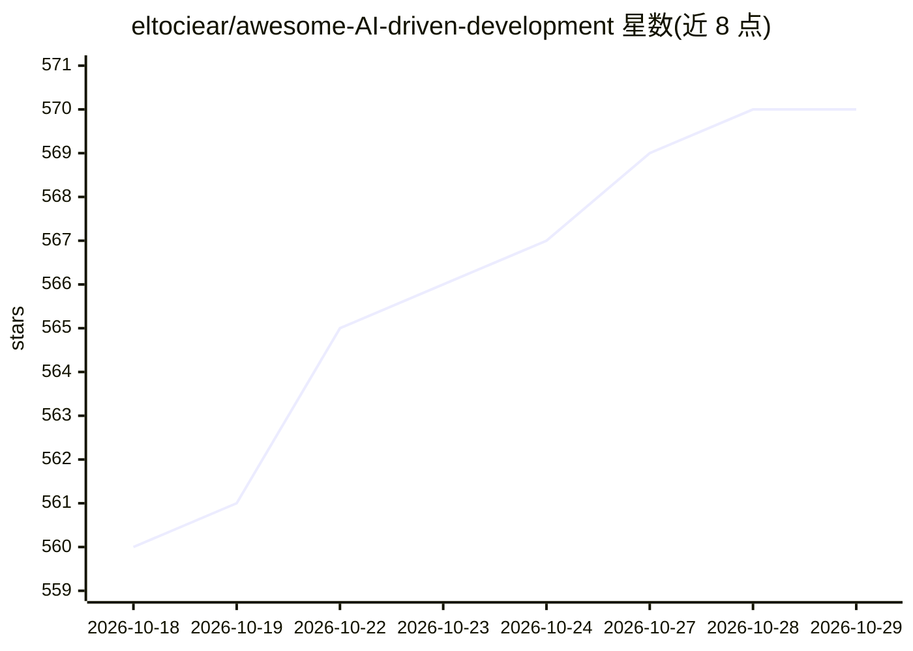

# eltociear/awesome-AI-driven-development

⭐ 570 · 推送 2026-10-12 · [GitHub](https://github.com/eltociear/awesome-AI-driven-development) · 个人维护

**AI 驱动开发工具的策展清单（601 个工具/资源）**

一个 awesome 类策展清单，收录 AI 编程开发相关工具、框架与资源共 601 项，灵感来自日本的「AI駆動開発」概念。已可见部分按 AI 代码编辑器与 IDE、终端与 CLI Agent、IDE 扩展（VS Code）等章节组织，条目含一句话描述。面向寻找 AI 辅助编程工具的开发者，列表本身无需安装，仓库不提供可运行代码。

## 筛选速览

| 维度 | 判定 | 备注 |
|---|---|---|
| AI 角色 | `ai-knowledge` | 知识聚合/清单类 |
| 许可风险 | `none` | — |
| 部署形态 | `library` | 以包/库形式分发 |
| 模型依赖 | — | README 未给出锁定关系 |
| 硬件要求 | — | 无带数字的原话,不猜 |
| 安装摩擦 | `low` | 无编译、无系统依赖或容器化 |
| 成熟度 | — | 结构信号不足 |

## 能力要点

- 收录 601 个 AI 驱动开发工具、框架与资源
- 按代码编辑器、终端 Agent、IDE 扩展等类别组织
- 条目附一句话描述与来源链接

## 适用场景

- 查找 AI 代码编辑器、终端编程 Agent 等 AI 开发工具
- 了解 AI 驱动开发领域的工具生态分布
- 对比 VS Code AI 扩展的候选选项

## 场景标签

`精选清单` · 领域:学习与行业

## 证据(README 行号)

> L6: A curated list of awesome AI-Driven development tools, frameworks, and resources. Currently featuring **601 tools** 
> L10: ## AI Code Editors & IDEs

## 星数曲线

2026-10-18 560 → 2026-10-29 570（+10）

---
*卡片 v1 · prompt 1.4 · 生成 2026-10-21 · 置信度 mid · 依据 README sha `2caa4f8dcc2a` · [字段定义](../../DATASET.md)*
