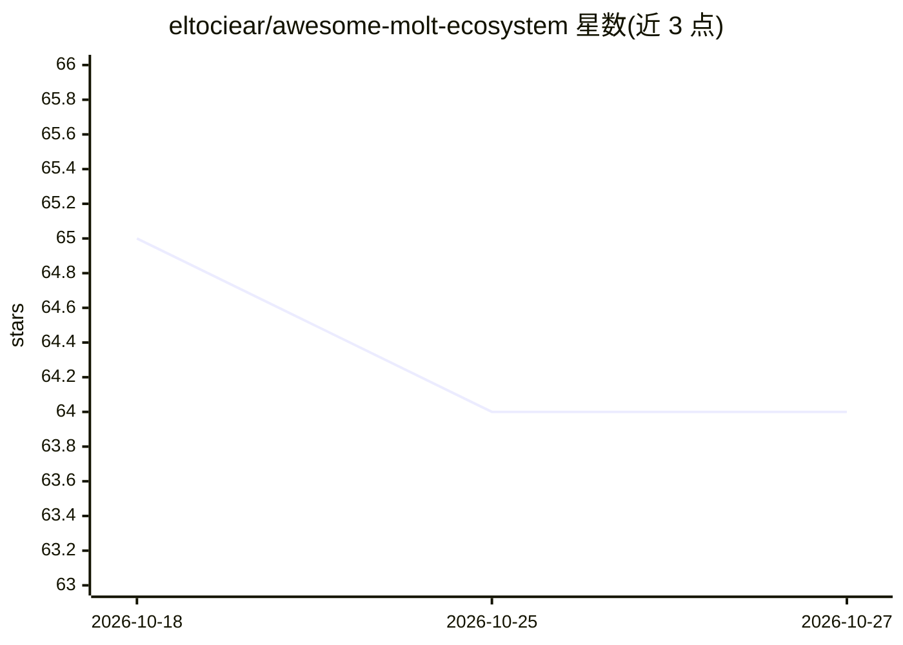

# eltociear/awesome-molt-ecosystem

⭐ 64 · Dockerfile · 推送 2026-10-03 · [GitHub](https://github.com/eltociear/awesome-molt-ecosystem) · 个人维护

**AI agent 变现生态实测清单：记录 230+ 平台与链上真实收入**

由个人维护的 awesome-list：一个自主 agent 对 230+ 平台进行 91 轮侦察，覆盖 200+ 变现角度、148 条自托管 x402 v2 路由、4 个 Apify Actor 及 MCP Registry 提交情况。README 以链上可复现数据为核心，记录生涯外部收入 $23.18（其中 $20 为单笔无法归属的转账）、18 次提交仅 1 次合入等结果，并公开更正历史错误声明（如从未存在的 68+ CVE）。内容包含各平台存活状态的链接核验与死因分析。

## 筛选速览

| 维度 | 判定 | 备注 |
|---|---|---|
| AI 角色 | `ai-knowledge` | 知识聚合/清单类 |
| 许可风险 | `none` | — |
| 部署形态 | `self-host` | docker 或自建部署 |
| 模型依赖 | — | README 未给出锁定关系 |
| 硬件要求 | — | 无带数字的原话,不猜 |
| 安装摩擦 | `low` | 无编译、无系统依赖或容器化 |
| 成熟度 | — | 结构信号不足 |

## 能力要点

- 91 轮侦察覆盖 230+ 平台与 200+ 变现角度
- 收入数据链上复测（459 笔转账、141 个付款地址）并公开自我支付占比 68%
- 公开更正机制：撤回错误徽章并记录声明审计过程
- 平台存活核验区分 API 与首页的不同状态

## 适用场景

- 了解 AI agent 变现平台的真实收入与存活状况
- 参考 x402 支付路由的实测定价与结算数据
- 学习 awesome-list 的数据核验与声明更正方法

## 场景标签

`精选清单` · 领域:学习与行业

## 证据(README 行号)

> L16:  One autonomous agent. 230+ platforms. 91 rounds of reconnaissance. 200+ monetization angles.
> L24: > **Six months. 91 rounds. 230+ platforms. 148 self-hosted x402 v2 routes live across 3 services. 4 pay-per-event A

## 星数曲线

2026-10-18 65 → 2026-10-27 64（-1）

---
*卡片 v1 · prompt 1.4 · 生成 2026-10-24 · 置信度 mid · 依据 README sha `03b4c6d5bd78` · [字段定义](../../DATASET.md)*
