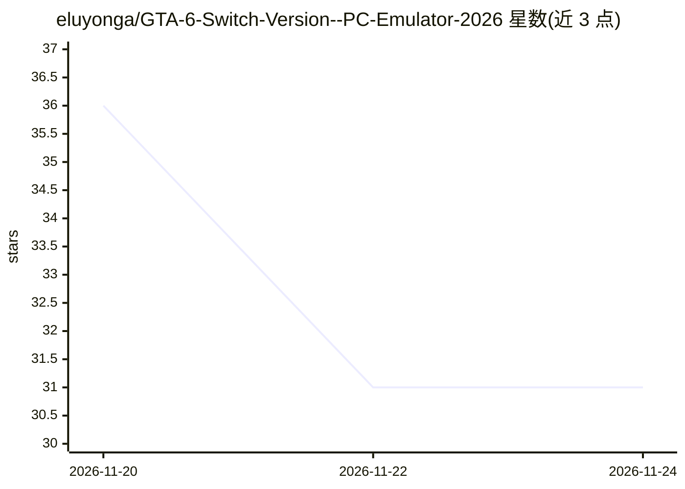

# eluyonga/GTA-6-Switch-Version--PC-Emulator-2026

⭐ — · [GitHub]() · 个人维护

**面向 Windows 玩家的 GTA VI PC 版安装与配置指南资源**

为等待 GTA VI PC 版的 Windows 玩家提供安装准备资源：系统兼容性检查清单（Windows 版本、DirectX、显卡驱动、存储）、图形与 FPS 优化说明、安装故障排查类别，以及指向 NVIDIA/AMD/Intel 驱动与 Rockstar Games Launcher 的官方链接。项目自带一个 Windows 安装包形式的配套工具（.exe），但 README 声明其不含、也不安装 GTA VI 游戏文件；官方 PC 配置需求尚未公布，页面以表格形式逐项标注未确认。

## 筛选速览

| 维度 | 判定 | 备注 |
|---|---|---|
| AI 角色 | `ai-knowledge` | 知识聚合/清单类 |
| 许可风险 | `permissive` | — |
| 部署形态 | `desktop` | 安装包/桌面程序 |
| 模型依赖 | — | README 未给出锁定关系 |
| 硬件要求 | — | 无带数字的原话,不猜 |
| 安装摩擦 | `low` | 无编译、无系统依赖或容器化 |
| 成熟度 | — | 结构信号不足 |

## 能力要点

- 提供 Windows 兼容性准备清单与安装故障排查类别
- 包含显卡驱动与 FPS 优化的通用配置说明
- 附带 Windows .exe 形式的配套工具安装包
- 系统需求表逐项标注待官方公布

## 适用场景

- PC 版发布前提前检查和准备 Windows 游戏环境
- 按通用 PC 游戏设置项了解图形与帧率优化方向
- 排查安装与显示相关的常见错误

## 场景标签

 · 领域:游戏/桌面工具

## 证据(README 行号)

> L5: A dedicated PC installation and configuration resource for Grand Theft Auto VI, covering Windows preparation, graphi
> L19: The installation resource focuses on:
> L49: The companion installer does not contain or install GTA VI game files.

## 星数曲线

2026-11-20 36 → 2026-11-24 31（-5）

---
*卡片 v1 · prompt 1.4 · 生成 2026-11-22 · 置信度 mid · 依据 README sha `2fe487426686` · [字段定义](../../DATASET.md)*
