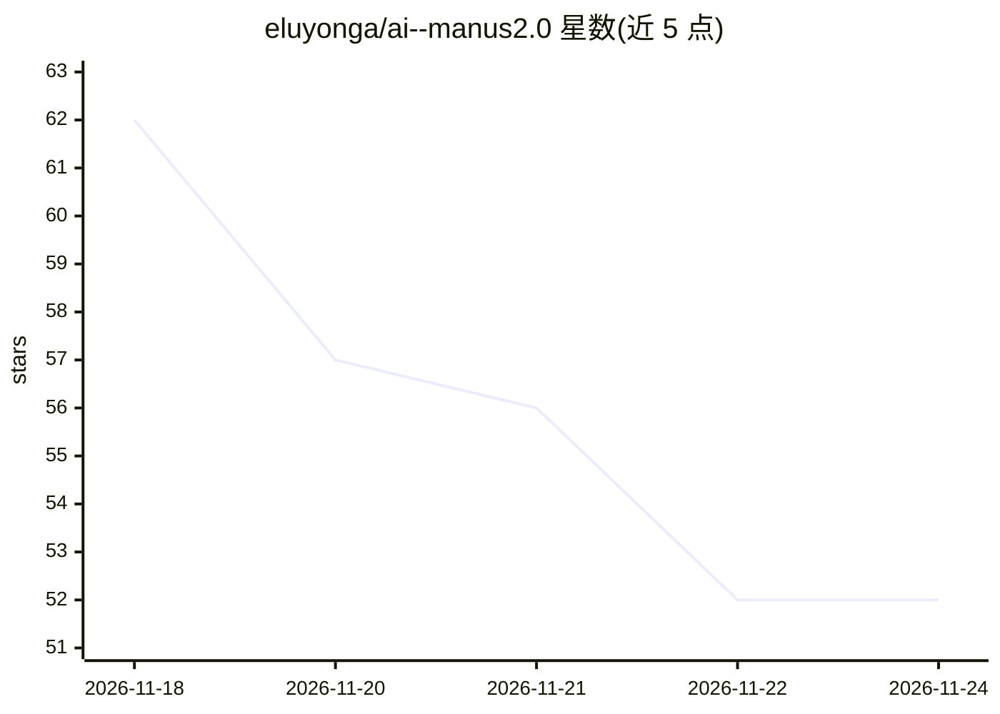

# eluyonga/ai--manus2.0

⭐ 52 · Apache-2.0 · 推送 2026-11-21 · [GitHub](https://github.com/eluyonga/ai--manus2.0) · 个人维护

**面向个人用户的自主 AI Agent：代用户执行代码与浏览器操作**

一个定位为自主 AI Agent 的产品，可在沙箱环境中运行代码、控制浏览器（导航网页、填写表单、采集信息），以多步骤方式代用户完成任务。README 将目标人群描述为学生、远程办公者与需要处理日常小事的个人用户，覆盖学习研究、家庭项目、轻量办公等场景。文档仅提供兼容性要求与使用步骤说明，未给出安装命令、源码或技术架构细节，也未提及任何模型接入方式。

## 筛选速览

| 维度 | 判定 | 备注 |
|---|---|---|
| AI 角色 | `ai-native` | 本体是模型或模型工具 |
| 许可风险 | `permissive` | Apache-2.0 |
| 部署形态 | `None` |  |
| 模型依赖 | — | README 未给出锁定关系 |
| 硬件要求 | — | 无带数字的原话,不猜 |
| 安装摩擦 | `low` | 无编译、无系统依赖或容器化 |
| 成熟度 | — | 结构信号不足 |

## 能力要点

- 自主执行代码完成任务的 Agent
- 浏览器控制：导航、填表、跨页面采集信息
- 后台持续运行的个人助手，跨会话保持任务模式

## 适用场景

- 让 Agent 帮我收集资料、整理研究笔记
- 自动填写重复性表单和多页面信息采集
- 把日常琐碎任务交给后台助手处理

## 场景标签

`AI 助手` `浏览器自动化` · 领域:效率与自动化

## 证据(README 行号)

> L18: Manus is an autonomous AI agent designed to run code and control a browser on your behalf. Instead of acting like a
> L22: Manus is not a heavy studio suite or a complex enterprise platform. It is a focused helper built for home, study, a

## 星数曲线

2026-11-18 62 → 2026-11-24 52（-10）

---
*卡片 v1 · prompt 1.4 · 生成 2026-11-19 · 置信度 low · 依据 README sha `52f78133c85b` · [字段定义](../../DATASET.md)*
