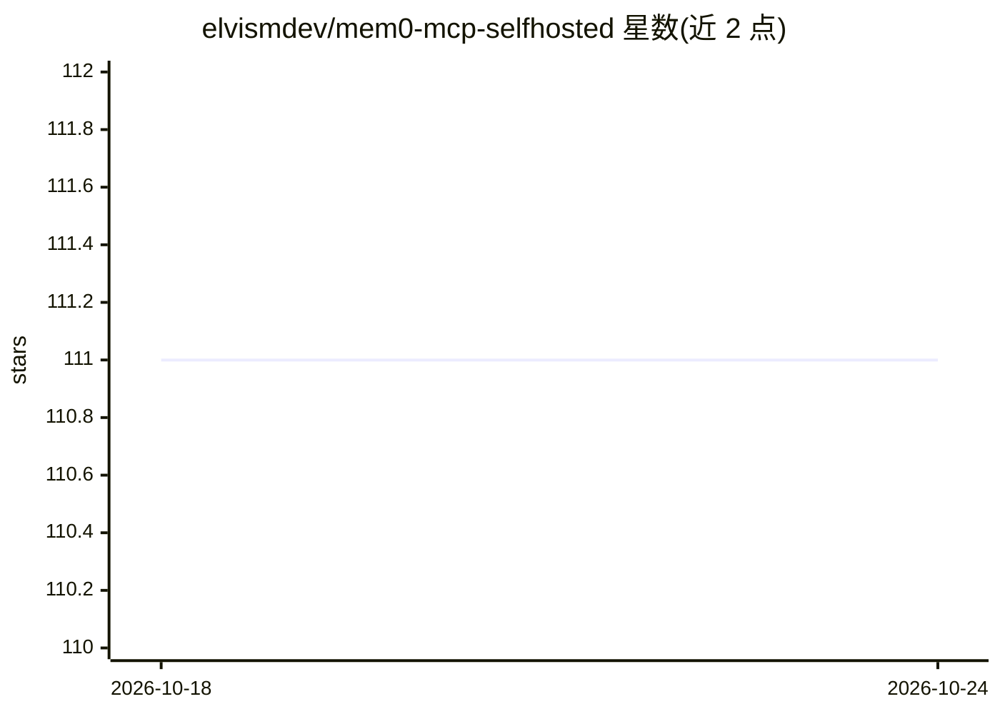

# elvismdev/mem0-mcp-selfhosted

⭐ 111 · Python · MIT · 推送 2026-03-13 · [GitHub](https://github.com/elvismdev/mem0-mcp-selfhosted) · 个人维护

**Claude Code 的自托管 mem0 记忆 MCP 服务器**

基于 mem0ai 库的 MCP 服务器，为 Claude Code 提供跨会话持久记忆：以自托管 Qdrant 做向量存储、Ollama 生成嵌入（bge-m3），可选 Neo4j 知识图谱。主 LLM 可选 Anthropic（自动读取 Claude Code 会话 OAT 令牌）或全本地方案的 Ollama。暴露 11 个 MCP 工具（9 个记忆管理 + 2 个图谱查询），并提供会话启动/结束时自动注入与保存记忆的 Hooks 和安装器。需 Python 3.10+ 与 uv，通过 uvx 从 GitHub 直接运行。

## 筛选速览

| 维度 | 判定 | 备注 |
|---|---|---|
| AI 角色 | `ai-ecosystem` | LLM/agent 周边工具 |
| 许可风险 | `permissive` | MIT |
| 部署形态 | `library` | 以包/库形式分发 |
| 模型依赖 | local-ok | 支持本地模型 |
| 硬件要求 | — | 无带数字的原话,不猜 |
| 安装摩擦 | `low` | 无编译、无系统依赖或容器化 |
| 成熟度 | — | 结构信号不足 |

## 能力要点

- 11 个 MCP 工具：9 个核心记忆操作 + 2 个 Neo4j 图谱查询
- 支持 Claude OAT 令牌零配置或 MEM0_PROVIDER=ollama 全本地运行
- 会话边界 Hooks：启动时注入相关记忆、结束时保存会话摘要
- OAT 令牌自动刷新（临近过期前 30 分钟，三步防御策略）

## 适用场景

- 让 Claude Code 跨会话记住项目架构与编码偏好
- 在自托管 Qdrant/Ollama 基础设施上运行记忆服务，避免云端依赖
- 通过 CLAUDE.md 规则让 Claude 在会话中主动检索和保存记忆

## 场景标签

`Agent 记忆` `知识图谱` · 领域:Agent 开发

## 证据(README 行号)

> L5: Self-hosted mem0 MCP server for Claude Code. Run a complete memory server against self-hosted Qdrant + Neo4j + Ollam
> L7: Uses the `mem0ai` package directly as a library, supports both Claude's OAT token and fully local Ollama setups, and

## 星数曲线

2026-10-18 111 → 2026-10-24 111（+0）

---
*卡片 v1 · prompt 1.4 · 生成 2026-10-23 · 置信度 mid · 依据 README sha `649876af77fa` · [字段定义](../../DATASET.md)*
