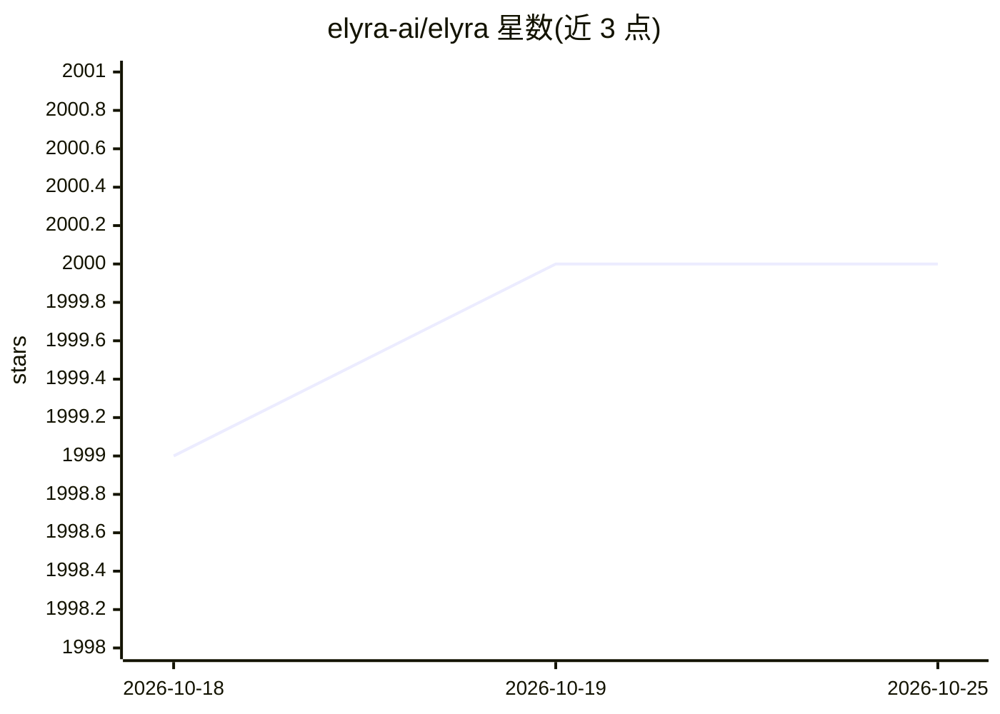

# elyra-ai/elyra

⭐ 2,000 · Python · Apache-2.0 · 推送 2026-10-20 · [GitHub](https://github.com/elyra-ai/elyra) · [官网](https://elyra.readthedocs.io/en/stable/) · 组织维护

**扩展 JupyterLab 的 AI 中心化工具集：可视化流水线与批处理运行**

面向使用 JupyterLab Notebook 的数据科学与 AI 开发者的扩展集合：提供可视化流水线编辑器，可将 notebook、Python 或 R 脚本作为批处理作业运行（对接 Apache Airflow/Kubeflow 等外部运行时主题），另含可复用代码片段、AI 助手集成（用于 notebook 单元格内的 AI 代码辅助，需按配置指南接入）、基于 Jupyter Enterprise Gateway 的混合运行时、Git 版本控制与语言服务器集成。通过 pip/conda 安装，或使用 Docker 镜像运行；旧版本安装需执行 jupyter lab build。

## 筛选速览

| 维度 | 判定 | 备注 |
|---|---|---|
| AI 角色 | `ai-enhanced` | 去掉 AI 部分产品仍成立 |
| 许可风险 | `permissive` | Apache-2.0 |
| 部署形态 | `desktop` | 安装包/桌面程序 |
| 模型依赖 | — | README 未给出锁定关系 |
| 硬件要求 | — | 无带数字的原话,不猜 |
| 安装摩擦 | `low` | 无编译、无系统依赖或容器化 |
| 成熟度 | `idea` | |

## 能力要点

- 可视化流水线编辑器，支持 notebook/Python/R 脚本作为批处理作业运行
- notebook 单元格内的 AI 助手代码辅助集成（需另行配置）
- 基于 Jupyter Enterprise Gateway 的本地/远程混合运行时
- 提供 Docker Hub 与 quay.io 容器镜像

## 适用场景

- 在 JupyterLab 中以可视化流水线编排 notebook 与脚本
- 把 notebook 作为批处理作业提交运行
- 在 notebook 编辑中获得 AI 代码辅助

## 场景标签

`工作流自动化` `代码生成` · 领域:效率与自动化

## 证据(README 行号)

> L11: Elyra is a set of AI-centric extensions to JupyterLab Notebooks.
> L18: - AI Assistant integration for AI-powered code assistance in notebook cells. See the AI Assistant setup guide for c

## 星数曲线

2026-10-18 1,999 → 2026-10-25 2,000（+1）

---
*卡片 v1 · prompt 1.4 · 生成 2026-10-21 · 置信度 high · 依据 README sha `75b4df94576a` · [字段定义](../../DATASET.md)*
