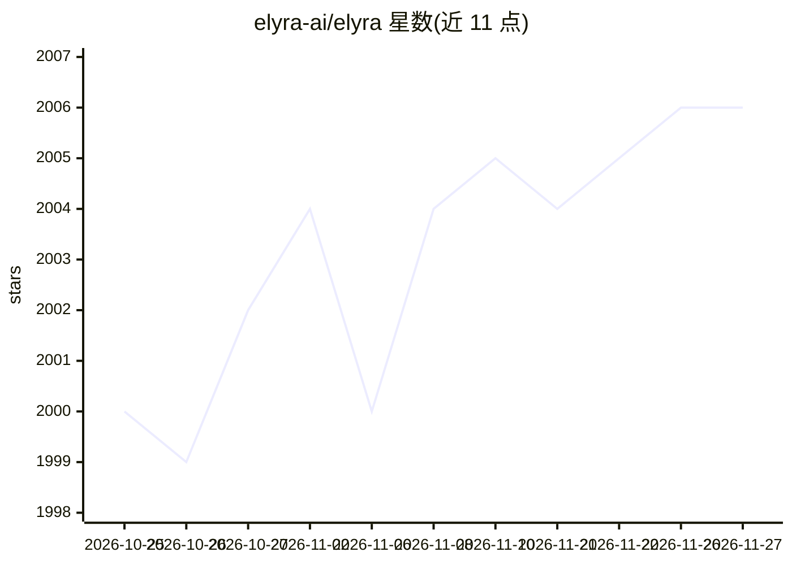

# elyra-ai/elyra

⭐ 2,006 · Python · Apache-2.0 · 推送 2026-11-18 · [GitHub](https://github.com/elyra-ai/elyra) · [官网](https://elyra.readthedocs.io/en/stable/) · 组织维护

**面向数据科学家的 JupyterLab AI 扩展套件**

Elyra 是一组 JupyterLab 扩展，提供可视化流水线编辑器、以批处理作业方式运行 notebook/Python/R 脚本、可复用代码片段、混合运行时支持（基于 Jupyter Enterprise Gateway）、脚本编辑器与调试器、目录导航、语言服务器协议集成及 Git 版本控制。AI 部分包括可配置的 AI Assistant 集成，为 notebook 单元格提供代码辅助。安装依赖 Node.js 22 与 Python 3.11+，支持 PyPI、conda-forge 与 Docker 容器镜像三种途径，需 JupyterLab 构建配合。

## 筛选速览

| 维度 | 判定 | 备注 |
|---|---|---|
| AI 角色 | `ai-enhanced` | 去掉 AI 部分产品仍成立 |
| 许可风险 | `permissive` | Apache-2.0 |
| 部署形态 | `desktop` | 安装包/桌面程序 |
| 模型依赖 | — | README 未给出锁定关系 |
| 硬件要求 | — | 无带数字的原话,不猜 |
| 安装摩擦 | `low` | 无编译、无系统依赖或容器化 |
| 成熟度 | — | 结构信号不足 |

## 能力要点

- 可视化流水线编辑器，支持将 notebook/Python/R 脚本作为批处理作业运行
- AI Assistant 集成，为 notebook 单元格提供 AI 代码辅助
- 基于 Jupyter Enterprise Gateway 的混合运行时支持
- 提供 PyPI、conda-forge 与 Docker Hub/quay.io 容器镜像

## 适用场景

- 在 JupyterLab 中以可视化方式编排 notebook 流水线
- 将 notebook 或脚本提交为批处理作业执行
- 在 notebook 开发中获得 AI 代码辅助

## 场景标签

`AI 助手` `工作流自动化` · 领域:效率与自动化

## 证据(README 行号)

> L11: Elyra is a set of AI-centric extensions to JupyterLab Notebooks.
> L18: - AI Assistant integration for AI-powered code assistance in notebook cells. See the AI Assistant setup guide for c
> L71: * Node.js 22

## 星数曲线

2026-10-25 2,000 → 2026-11-27 2,006（+6）

---
*卡片 v1 · prompt 1.4 · 生成 2026-11-23 · 置信度 high · 依据 README sha `981d22b87f88` · [字段定义](../../DATASET.md)*
