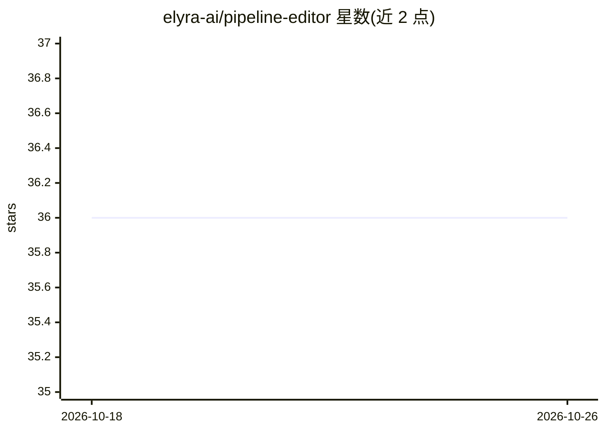

# elyra-ai/pipeline-editor

⭐ 36 · TypeScript · Apache-2.0 · 推送 2026-10-20 · [GitHub](https://github.com/elyra-ai/pipeline-editor) · [官网](https://elyra.readthedocs.io/) · 组织维护

**编辑 pipeline 文件的 React 组件库，供 Elyra 各客户端复用**

以 npm 包 @elyra/pipeline-editor 形式提供的 React 组件，用于可视化编辑 pipeline 文件，被 Elyra 应用与浏览器扩展共同使用。支持 npm/yarn 安装，也可 git clone 后用 make 本地构建并 yarn link 到项目中调试；代码中通过 import PipelineEditor 引入使用。本身不执行 pipeline，主题标签表明其面向 Airflow、Kubeflow Pipelines 等机器学习 pipeline 场景的编辑界面构建。

## 筛选速览

| 维度 | 判定 | 备注 |
|---|---|---|
| AI 角色 | `ai-ecosystem` | LLM/agent 周边工具 |
| 许可风险 | `permissive` | Apache-2.0 |
| 部署形态 | `library` | 以包/库形式分发 |
| 模型依赖 | — | README 未给出锁定关系 |
| 硬件要求 | — | 无带数字的原话,不猜 |
| 安装摩擦 | `low` | 无编译、无系统依赖或容器化 |
| 成熟度 | — | 结构信号不足 |

## 能力要点

- 以 npm 包分发的 React pipeline 编辑器组件
- 被 Elyra 应用与浏览器扩展共用
- 支持本地构建并通过 yarn link 联调

## 适用场景

- 为 Elyra 相关客户端构建 pipeline 可视化编辑界面
- 在自有 React 项目中嵌入 pipeline 编辑组件

## 场景标签

 · 领域:数据科学工作流/前端组件

## 证据(README 行号)

> L5:  A react component for editing pipeline files. Used across all Elyra applications and browser extensions.

## 星数曲线

2026-10-18 36 → 2026-10-26 36（+0）

---
*卡片 v1 · prompt 1.4 · 生成 2026-10-25 · 置信度 high · 依据 README sha `5b807e6150dc` · [字段定义](../../DATASET.md)*
