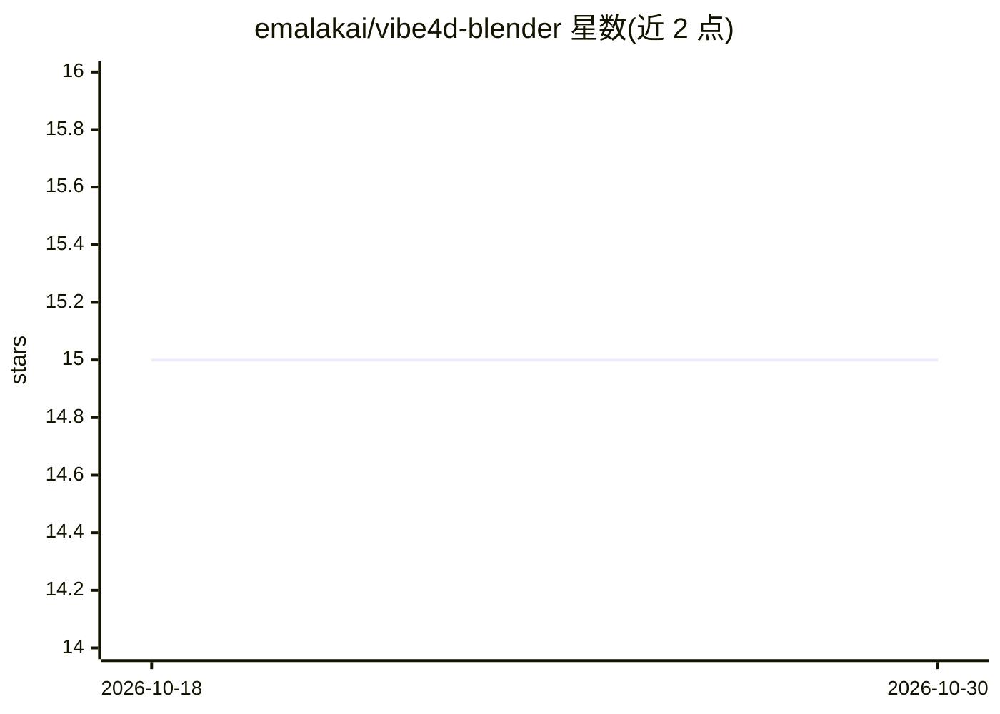

# emalakai/vibe4d-blender

⭐ 15 · Python · GPL-3.0 · 推送 2026-06-01 · [GitHub](https://github.com/emalakai/vibe4d-blender) · [官网](https://vibe4d.com) · 个人维护

**Blender 插件：左侧面板内置 AI 聊天助手**

一个 Blender 插件，在界面左侧添加包含 AI 聊天的自定义面板，用于通过提示词与 AI 交互辅助 Blender 操作。分发方式为 Gumroad 订阅制：订阅任意 Vibe4D 档位后获取插件 .zip 文件与个人许可密钥，在 Blender 的插件安装入口导入 zip 并在授权窗口输入密钥激活。要求 Blender 4.4 或更高版本。本地 LLM 支持标注为 TODO，尚未提供。

## 筛选速览

| 维度 | 判定 | 备注 |
|---|---|---|
| AI 角色 | `ai-enhanced` | 去掉 AI 部分产品仍成立 |
| 许可风险 | `viral` | GPL-3.0 |
| 部署形态 | `None` |  |
| 模型依赖 | — | README 未给出锁定关系 |
| 硬件要求 | — | 无带数字的原话,不猜 |
| 安装摩擦 | `low` | 无编译、无系统依赖或容器化 |
| 成熟度 | — | 结构信号不足 |

## 能力要点

- 在 Blender 左侧添加带 AI 聊天的自定义 UI 面板
- 通过 Blender 插件系统以 .zip 方式安装
- 需在授权窗口输入许可密钥激活
- 要求 Blender 4.4 或更高版本

## 适用场景

- 在 Blender 内通过聊天面板与 AI 助手交互
- 以提示词驱动的方式辅助建模工作流

## 场景标签

`AI 助手` · 领域:对话与助手

## 证据(README 行号)

> L3: **The Ultimate Blender AI Assistant**
> L5: Adds a custom UI panel in the left with the AI chat.

## 星数曲线

2026-10-18 15 → 2026-10-30 15（+0）

---
*卡片 v1 · prompt 1.4 · 生成 2026-10-30 · 置信度 mid · 依据 README sha `03c7271496ed` · [字段定义](../../DATASET.md)*
