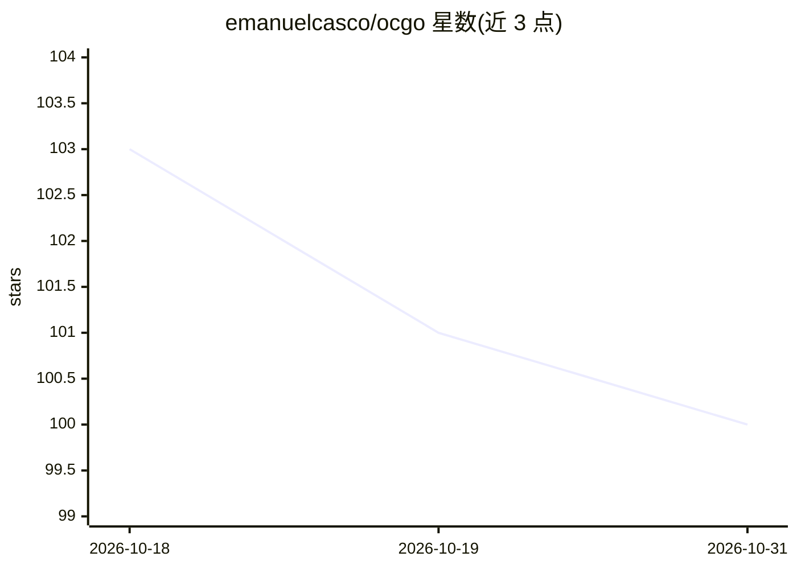

# emanuelcasco/ocgo

⭐ 100 · Go · MIT · 推送 2026-06-04 · [GitHub](https://github.com/emanuelcasco/ocgo) · 个人维护

**让 Claude Code / Codex CLI 使用 OpenCode Go 订阅的本地代理 CLI**

Go 编写的命令行工具：在本地 127.0.0.1:3456 启动兼容代理，将 Claude Code 的 Anthropic Messages 请求转换为 OpenAI 兼容格式，为 Codex CLI 暴露 OpenAI Chat Completions 与轻量 Responses 适配层，并把上游请求转发到 OpenCode Go 端点、注入用户 API key。支持模型名映射路由（如 claude-sonnet→kimi-k2.6）、流式响应与基础工具调用翻译。限制：token 计数返回 0，兼容性聚焦两款 CLI 所需的请求/响应形态而非完整 API 对等。面向已持有 OpenCode Go 订阅的开发者，通过 Homebrew 或源码安装。

## 筛选速览

| 维度 | 判定 | 备注 |
|---|---|---|
| AI 角色 | `ai-ecosystem` | LLM/agent 周边工具 |
| 许可风险 | `permissive` | MIT |
| 部署形态 | `None` |  |
| 模型依赖 | — | README 未给出锁定关系 |
| 硬件要求 | — | 无带数字的原话,不猜 |
| 安装摩擦 | `medium` | 含编译或系统依赖之一 |
| 成熟度 | — | 结构信号不足 |

## 能力要点

- 本地兼容代理同时暴露 Anthropic 与 OpenAI 兼容端点
- 一条命令启动 Claude Code / Codex CLI 并自动配置环境
- 模型名映射路由（精确与 family 匹配）
- 为 Codex 生成模型目录 ~/.codex/ocgo-models.json

## 适用场景

- 用 OpenCode Go 订阅驱动 Claude Code 或 Codex CLI 编程助手
- 把 Claude/GPT 模型名透明路由到 kimi、deepseek 等 OpenCode Go 模型
- 免手动配置代理即可切换编码 CLI 的模型后端

## 场景标签

`模型网关` · 领域:Agent 开发

## 证据(README 行号)

> L24: `ocgo` is a small Go CLI that lets Claude Code and Codex CLI run against an OpenCode Go subscription. It starts a l
> L398: `ocgo` exposes a local compatibility API used by Claude Code and Codex CLI:
> L406: Requests sent to `/v1/messages` are converted from Anthropic Messages format into OpenAI-compatible chat completio

## 星数曲线

2026-10-18 103 → 2026-10-31 100（-3）

---
*卡片 v1 · prompt 1.4 · 生成 2026-10-23 · 置信度 high · 依据 README sha `76f225d7f181` · [字段定义](../../DATASET.md)*
