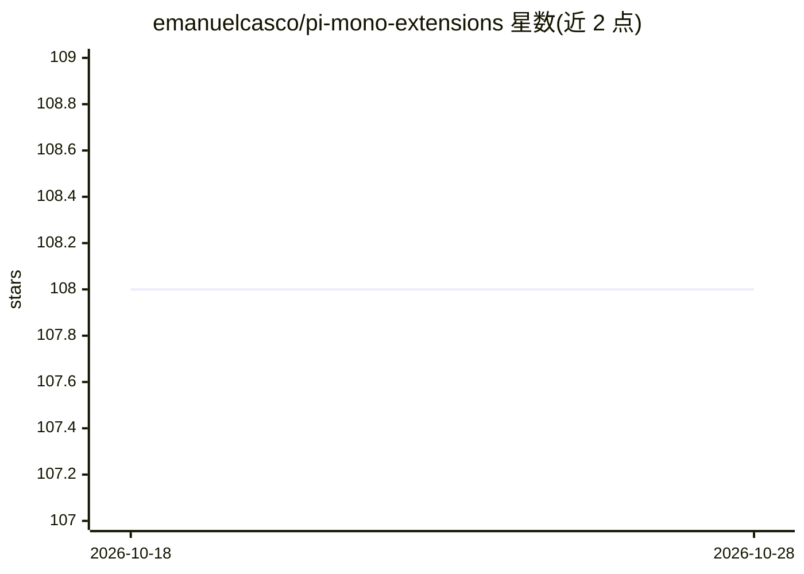

# emanuelcasco/pi-mono-extensions

⭐ 108 · TypeScript · MIT · 推送 2026-08-26 · [GitHub](https://github.com/emanuelcasco/pi-mono-extensions) · 个人维护

**pi 编码代理的扩展集合：工具、斜杠命令、安全防护等**

pnpm workspace 形式的 pi coding agent 扩展合集，每个 extensions/ 下的包为 pi 增加一项独立能力：结构化提问工具、自动代码修复、Figma/Linear 原生工具集成、多文件批量编辑、定时循环命令、PR/MR 审查、秘密扫描与令牌保险库、上下文用量报表等。可通过 `pi install npm:pi-mono-all` 一次安装全部，或按包名单独安装；支持 `pi -e` 本地临时加载用于测试。面向使用 pi 编码代理的开发者。

## 筛选速览

| 维度 | 判定 | 备注 |
|---|---|---|
| AI 角色 | `ai-ecosystem` | LLM/agent 周边工具 |
| 许可风险 | `permissive` | MIT |
| 部署形态 | `None` |  |
| 模型依赖 | — | README 未给出锁定关系 |
| 硬件要求 | — | 无带数字的原话,不猜 |
| 安装摩擦 | `low` | 无编译、无系统依赖或容器化 |
| 成熟度 | — | 结构信号不足 |

## 能力要点

- 18 个独立扩展：工具注册、斜杠命令、TUI 面板、安全防护等
- 一次安装全量包或按需安装单个扩展
- sentinel 扩展提供秘密扫描、风险操作拦截与令牌占位符保险库
- multi-edit 支持批量编辑与补丁载荷，写入前经虚拟文件系统校验

## 适用场景

- 为 pi 编码代理增加 Figma 设计稿转代码的工具链
- 在代理会话中自动拦截含密钥的读取与高风险写入操作
- 通过 /review 命令审查 GitHub PR 或 GitLab MR 并提交评论
- 用 /loop 定时重复执行检查或测试任务

## 场景标签

`编码 Agent` `代码审查` · 领域:编码与开发

## 证据(README 行号)

> L3: `pi-mono-extensions` is a pnpm workspace that collects installable extensions for the pi coding agent. Each package 
> L5: You can install the full bundle with one command, or install only the extensions you need. This README is the top-le

## 星数曲线

2026-10-18 108 → 2026-10-28 108（+0）

---
*卡片 v1 · prompt 1.4 · 生成 2026-10-23 · 置信度 high · 依据 README sha `7bb182d7f83a` · [字段定义](../../DATASET.md)*
