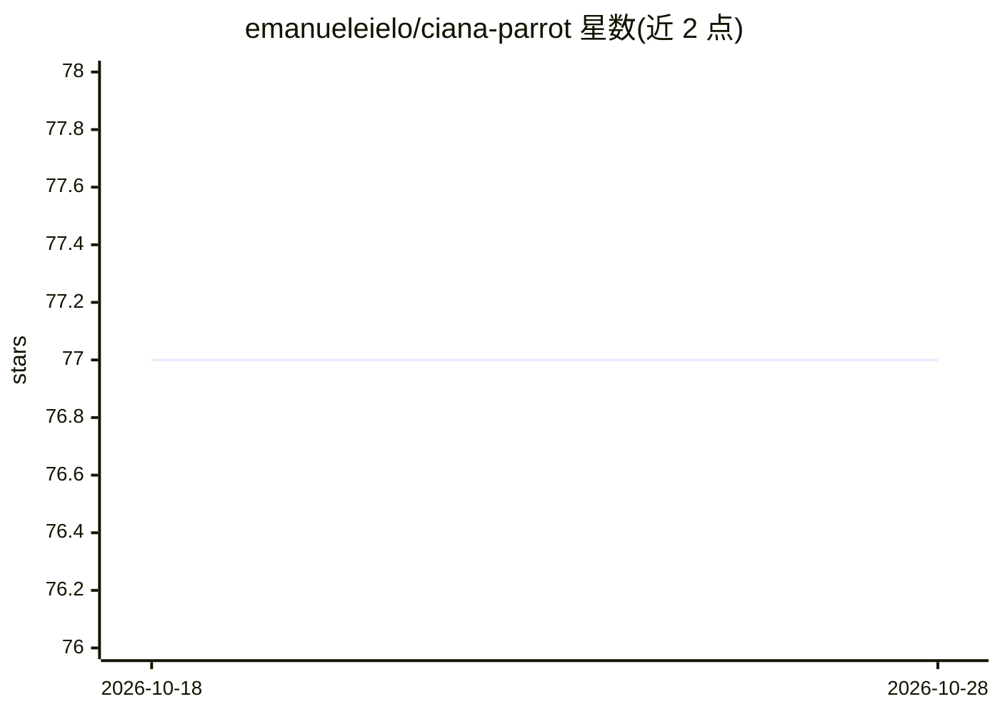

# emanueleielo/ciana-parrot

⭐ 77 · Python · MIT · 推送 2026-10-05 · [GitHub](https://github.com/emanueleielo/ciana-parrot) · [官网](https://cianaparrot.dev) · 个人维护

**自托管的个人 AI 助手：Telegram 聊天加定时任务**

运行在自有基础设施上的 AI 个人助理，Docker 沙箱化部署，通过 host gateway 安全桥接宿主机的 Spotify、Obsidian、1Password、HomeKit 等本地工具。基于 DeepAgents/LangChain/LangGraph 构建，支持多提供商 LLM（Anthropic/OpenAI/Gemini/Groq/Ollama/OpenRouter/vLLM）与多档模型路由，内置 Telegram 聊天、cron/间隔/一次性定时任务、文件夹式技能注册、MCP 接入与 Markdown 持久记忆，单一 YAML 文件配置。MIT 许可，个人维护。

## 筛选速览

| 维度 | 判定 | 备注 |
|---|---|---|
| AI 角色 | `ai-native` | 本体是模型或模型工具 |
| 许可风险 | `permissive` | MIT |
| 部署形态 | `self-host` | docker 或自建部署 |
| 模型依赖 | local-ok | 支持本地模型 |
| 硬件要求 | — | 无带数字的原话,不猜 |
| 安装摩擦 | `low` | 无编译、无系统依赖或容器化 |
| 成熟度 | — | 结构信号不足 |

## 能力要点

- 多提供商 LLM 与 lite→expert 多档模型中转切换
- Docker 沙箱 + host gateway 桥接宿主 CLI 工具（Spotify/Obsidian/HomeKit 等）
- 聊天中创建 cron/间隔/一次性定时任务
- skills/ 文件夹放入即自动注册为 agent 工具，支持 MCP 服务器接入

## 适用场景

- 在 Telegram 上与自托管 AI 助手对话并让它操作本地工具
- 让 AI 定时自动执行任务（如提醒、日报）
- 通过编写技能文件夹扩展助手的能力

## 场景标签

`AI 助手` `聊天机器人` `工作流自动化` · 领域:效率与自动化

## 证据(README 行号)

> L7:  Self-hosted AI assistant with multi-channel support, scheduled tasks, and extensible skills.
> L16: CianaParrot is a self-hosted AI personal assistant that runs on your own infrastructure — sandboxed inside Docker, 

## 星数曲线

2026-10-18 77 → 2026-10-28 77（+0）

---
*卡片 v1 · prompt 1.4 · 生成 2026-10-24 · 置信度 high · 依据 README sha `6ea2a89ccc92` · [字段定义](../../DATASET.md)*
