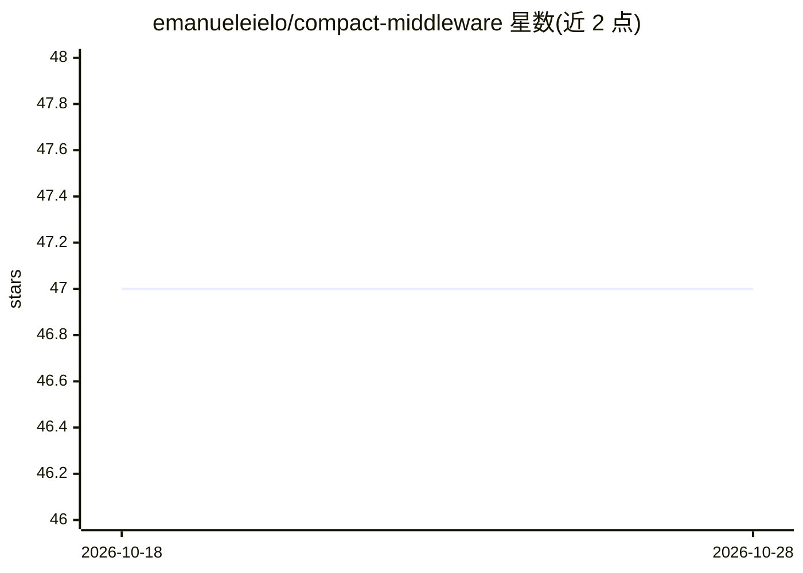

# emanueleielo/compact-middleware

⭐ 47 · Python · MIT · 推送 2026-10-05 · [GitHub](https://github.com/emanueleielo/compact-middleware) · [官网](https://pypi.org/project/compact-middleware/) · 个人维护

**DeepAgents 中间件：移植 Claude Code 的上下文压缩管线**

为 DeepAgents/LangGraph agent 提供的可组合中间件，把 Claude Code 的 compaction 管线封装为一行导入：每轮运行免费的三级轻量压缩（消息折叠、参数截断、微压缩），仅在 token 超全局阈值时触发 LLM 摘要（9 段结构化 prompt），压缩后自动恢复最近 5 个文件与活动计划，含失败断路器与混合 token 计数（真实 API usage + 启发式尾部）。以 pip 包分发，支持 Anthropic、OpenAI 及 LangChain 兼容 provider。默认配置对齐 Claude Code 生产设置，各触发器与预算均可覆盖。

## 筛选速览

| 维度 | 判定 | 备注 |
|---|---|---|
| AI 角色 | `ai-ecosystem` | LLM/agent 周边工具 |
| 许可风险 | `permissive` | MIT |
| 部署形态 | `library` | 以包/库形式分发 |
| 模型依赖 | — | README 未给出锁定关系 |
| 硬件要求 | — | 无带数字的原话,不猜 |
| 安装摩擦 | `low` | 无编译、无系统依赖或容器化 |
| 成熟度 | — | 结构信号不足 |

## 能力要点

- 每轮运行的三级免费轻量压缩 + 阈值门控的 LLM 摘要级联
- 9 段结构化摘要 prompt，压缩后自动恢复文件与计划
- 混合 token 计数：回溯最近真实 API usage，尾部启发式估算
- 可配置断路器、部分压缩（前缀/后缀）与自定义触发格式

## 适用场景

- 长时间运行的 DeepAgents 会话避免撞上下文窗口
- 压缩后保留文件路径、代码与用户原始意图
- 低成本清理过期的工具调用结果

## 场景标签

`Agent 框架` `Agent 记忆` · 领域:Agent 开发

## 证据(README 行号)

> L3:  Claude Code's compaction engine, as a drop-in DeepAgents middleware.
> L18: **compact-middleware** takes the battle-tested compaction pipeline from Claude Code and makes it a composable DeepA
> L60: from deepagents import create_deep_agent

## 星数曲线

2026-10-18 47 → 2026-10-28 47（+0）

---
*卡片 v1 · prompt 1.4 · 生成 2026-10-25 · 置信度 high · 依据 README sha `ad5bc86b7fe8` · [字段定义](../../DATASET.md)*
