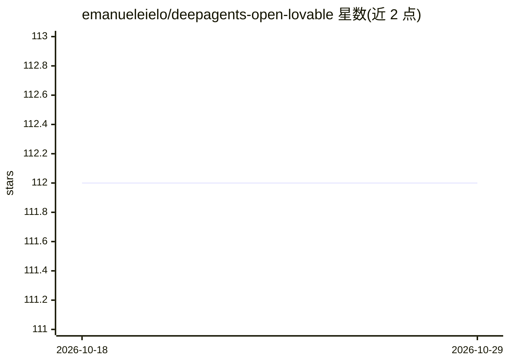

# emanueleielo/deepagents-open-lovable

⭐ 112 · TypeScript · 推送 2026-10-05 · [GitHub](https://github.com/emanueleielo/deepagents-open-lovable) · 个人维护

**用自然语言对话生成完整 React 应用的开源前端开发平台**

基于 DeepAgents 与 LangGraph 的开源前端开发平台：用户用自然语言描述需求，AI agent 生成使用 React、Next.js、Tailwind CSS 与 shadcn/ui 的代码，支持实时预览、生成文件的管理、一键部署到 Vercel。架构含设计/图像检索等专用子 agent。需自备 Anthropic API key，前后端分别为 Python 3.11+ 与 Node.js 18+，克隆源码并分别启动 langgraph dev 与 npm run dev 运行。

## 筛选速览

| 维度 | 判定 | 备注 |
|---|---|---|
| AI 角色 | `ai-native` | 本体是模型或模型工具 |
| 许可风险 | `none` | — |
| 部署形态 | `None` |  |
| 模型依赖 | locked-api |  |
| 硬件要求 | — | 无带数字的原话,不猜 |
| 安装摩擦 | `low` | 无编译、无系统依赖或容器化 |
| 成熟度 | — | 结构信号不足 |

## 能力要点

- 自然语言对话生成 React/Next.js/Tailwind/shadcn 代码
- 实时预览（Sandpack）与生成文件系统管理
- 设计、图像检索等专用子 agent 架构
- 一键部署到 Vercel 获得预览 URL

## 适用场景

- 通过对话描述需求快速生成前端应用原型
- 实时查看 AI 生成代码的渲染效果并编辑文件
- 将生成的应用一键部署到 Vercel 预览

## 场景标签

`代码生成` · 领域:编码与开发

## 证据(README 行号)

> L3: An open-source AI-powered frontend development platform built on DeepAgents and LangGraph. Generate complete React a
> L9: This platform enables you to build frontend applications by simply describing what you want. The AI agent understand

## 星数曲线

2026-10-18 112 → 2026-10-29 112（+0）

---
*卡片 v1 · prompt 1.4 · 生成 2026-10-23 · 置信度 high · 依据 README sha `c95ff0821895` · [字段定义](../../DATASET.md)*
