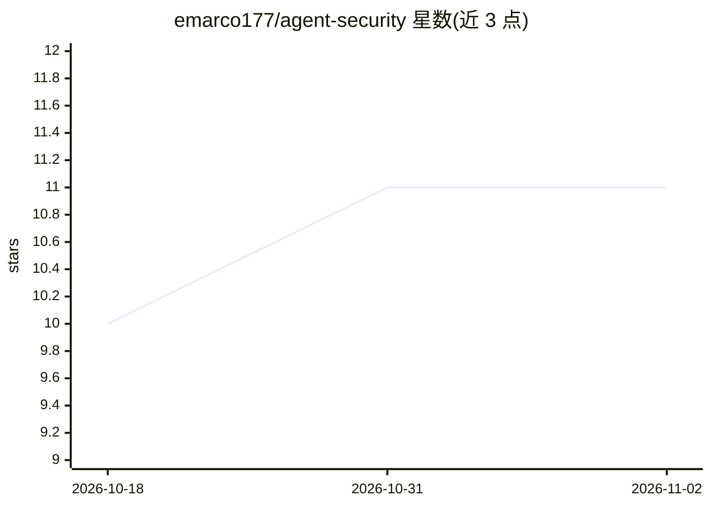

# emarco177/agent-security

⭐ 11 · Python · Apache-2.0 · 推送 2026-06-05 · [GitHub](https://github.com/emarco177/agent-security) · [官网](https://github.com/emarco177/agent-security) · 个人维护

**面向工程师的 AI agent 安全攻防实操教学仓库（6 个演示）**

基于 LangChain + LangGraph 构建的 IT 服务台演示应用（TechCorp），提供 6 个递进式攻击演示：每个演示针对一个真实生产环境攻击向量（提示注入、租户隔离、间接注入、记忆投毒、越权等），先复现攻击、再以 LangChain 中间件（可组合钩子拦截模型调用与工具执行）实施修复并验证，映射 OWASP LLM Top 10。部署在 GCP Cloud Run，配合 Firebase Auth/Firestore 与 LangSmith 追踪。声明仅用于教育与防御目的，攻击运行在自建沙箱项目中。前置要求 uv、Docker、gcloud CLI 与 OpenAI API key。

## 筛选速览

| 维度 | 判定 | 备注 |
|---|---|---|
| AI 角色 | `ai-knowledge` | 知识聚合/清单类 |
| 许可风险 | `permissive` | Apache-2.0 |
| 部署形态 | `None` |  |
| 模型依赖 | — | README 未给出锁定关系 |
| 硬件要求 | — | 无带数字的原话,不猜 |
| 安装摩擦 | `low` | 无编译、无系统依赖或容器化 |
| 成熟度 | — | 结构信号不足 |

## 能力要点

- 6 个攻击向量演示，每个遵循攻击→证明→修复→验证的流程
- 安全修复以 LangChain 中间件类实现（wrap_tool_call/before_model/after_model 钩子）
- 映射 OWASP LLM Top 10（LLM01/02/05/06）
- 部署于 GCP Cloud Run + Firebase Auth，单脚本 deploy_gcloud.sh 完成部署

## 适用场景

- 工程师在沙箱环境中动手复现提示注入与越权攻击
- 安全团队学习 agent 生产部署的防御架构模式
- 按 OWASP LLM 分类逐项验证防御措施

## 场景标签

`网络安全` `教程课程` · 领域:学习与行业

## 证据(README 行号)

> L13: This repository is a hands-on breakdown of how AI agents break and how to fix them. Six progressive demos, each tar
> L38: Each demo follows the same pattern: **attack** the agent, **prove** the damage, **apply** the fix, **verify** the f
> L51: ## OWASP LLM Top 10 Coverage

## 星数曲线

2026-10-18 10 → 2026-11-02 11（+1）

---
*卡片 v1 · prompt 1.4 · 生成 2026-11-02 · 置信度 high · 依据 README sha `7b22ccb27db9` · [字段定义](../../DATASET.md)*
