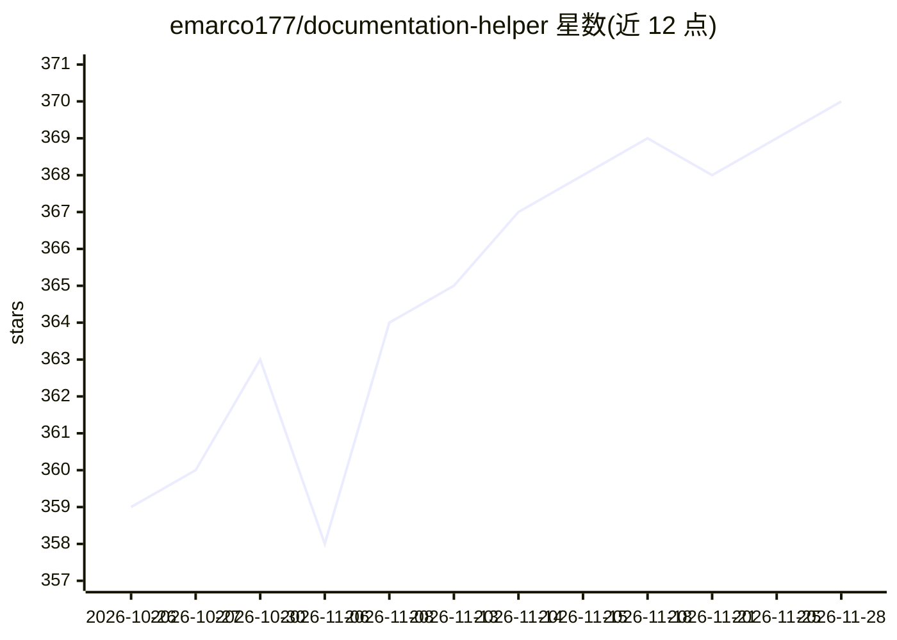

# emarco177/documentation-helper

⭐ 370 · Jupyter Notebook · Apache-2.0 · 推送 2026-11-27 · [GitHub](https://github.com/emarco177/documentation-helper) · [官网](https://www.udemy.com/course/langchain/) · 个人维护

**基于 LangChain RAG 的文档问答助手参考实现**

一个 chat.langchain.com 精简版参考实现：用 Tavily 爬取 LangChain 文档、分块后经 embedding 写入 Pinecone，查询时做上下文检索并配会话记忆进行指代消解，最终由 OpenAI GPT 生成带来源引用的回答，前端为 Streamlit 聊天界面。需自备 OpenAI、Pinecone、Tavily 三个 API key，附两个 Jupyter 教程笔记本，作者定位为学习 LangChain/RAG 架构的教学项目。

## 筛选速览

| 维度 | 判定 | 备注 |
|---|---|---|
| AI 角色 | `ai-native` | 本体是模型或模型工具 |
| 许可风险 | `permissive` | Apache-2.0 |
| 部署形态 | `None` |  |
| 模型依赖 | — | README 未给出锁定关系 |
| 硬件要求 | — | 无带数字的原话,不猜 |
| 安装摩擦 | `low` | 无编译、无系统依赖或容器化 |
| 成熟度 | — | 结构信号不足 |

## 能力要点

- Tavily 实时爬取文档→分块→Pinecone 向量索引的完整摄取管线
- 会话记忆做指代消解与上下文延续
- 回答附带来源引用
- 附 Tavily API 与爬取功能教程笔记本

## 适用场景

- 对 LangChain 文档内容进行问答
- 学习 RAG 架构的端到端实现
- 参考会话记忆与向量检索的集成方式

## 场景标签

`文档问答` `RAG` `教程课程` · 领域:知识与检索

## 证据(README 行号)

> L19: The **LangChain Documentation Helper** is a sophisticated AI-powered web application that serves as a slim version 
> L30: 6. 🧠 **Context-Aware Generation**: Provides accurate, contextual answers with source citations

## 星数曲线

2026-10-26 359 → 2026-11-28 370（+11）

---
*卡片 v1 · prompt 1.4 · 生成 2026-11-25 · 置信度 high · 依据 README sha `51fdf14580f3` · [字段定义](../../DATASET.md)*
