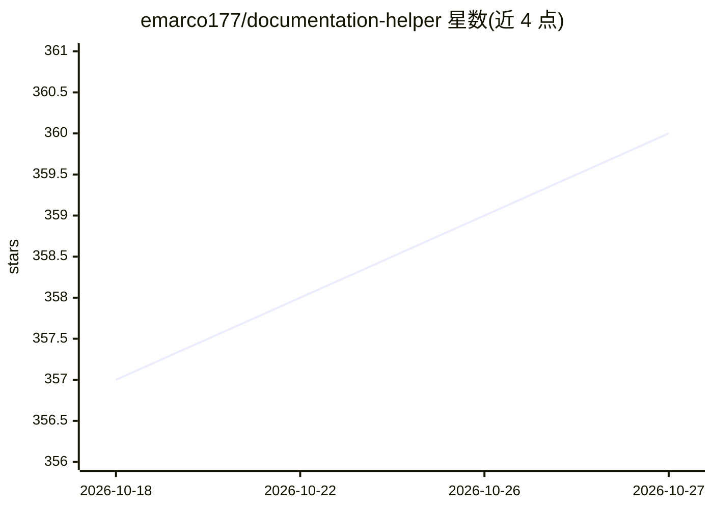

# emarco177/documentation-helper

⭐ 360 · Jupyter Notebook · Apache-2.0 · 推送 2026-04-02 · [GitHub](https://github.com/emarco177/documentation-helper) · [官网](https://www.udemy.com/course/langchain/) · 个人维护

**面向 LangChain 文档的 RAG 问答参考实现应用**

基于 LangChain、Pinecone、Tavily 与 OpenAI 构建的文档问答 Web 应用，定位为 chat.langchain.com 的精简版：通过 Tavily 实时爬取 LangChain 文档，切块后经 Pinecone 做向量检索，结合对话记忆生成带来源引用的回答，前端由 Streamlit 提供。安装需 Python 3.8+ 并配置 OpenAI、Pinecone、Tavily 三项 API key，用 pipenv 装依赖，先运行 ingestion.py 建索引再启动 Streamlit。项目附有两个 Tavily 教学 notebook，定位为学习 RAG 架构的教学工具。

## 筛选速览

| 维度 | 判定 | 备注 |
|---|---|---|
| AI 角色 | `ai-native` | 本体是模型或模型工具 |
| 许可风险 | `permissive` | Apache-2.0 |
| 部署形态 | `None` |  |
| 模型依赖 | — | README 未给出锁定关系 |
| 硬件要求 | — | 无带数字的原话,不猜 |
| 安装摩擦 | `low` | 无编译、无系统依赖或容器化 |
| 成熟度 | — | 结构信号不足 |

## 能力要点

- Tavily 实时爬取 LangChain 文档并建立索引
- Pinecone 向量存储与相似度检索
- 对话记忆支持共指消解与上下文连续性
- 附 Tavily API 与爬取功能的教学 notebook

## 适用场景

- 通过对话界面查询 LangChain 文档获得带引用的回答
- 学习 RAG 流水线（爬取/切块/向量检索/生成）的实现
- 作为自定义文档问答应用的参考实现进行改造

## 场景标签

`文档问答` `RAG` · 领域:知识与检索

## 证据(README 行号)

> L19: The **LangChain Documentation Helper** is a sophisticated AI-powered web application that serves as a slim version 
> L25: 1. 🌐 **Web Crawling**: Real-time web scraping and content extraction using Tavily's advanced crawling capabilities

## 星数曲线

2026-10-18 357 → 2026-10-27 360（+3）

---
*卡片 v1 · prompt 1.4 · 生成 2026-10-21 · 置信度 high · 依据 README sha `ff7a10549b75` · [字段定义](../../DATASET.md)*
