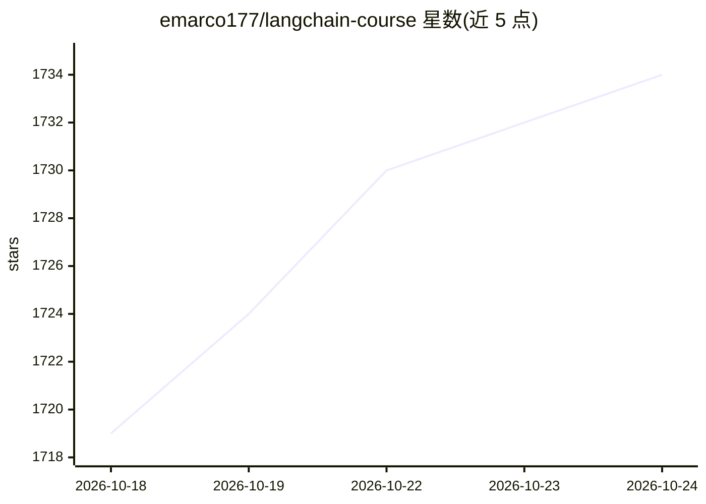

# emarco177/langchain-course

⭐ 1,734 · Apache-2.0 · 推送 2026-10-17 · [GitHub](https://github.com/emarco177/langchain-course) · [官网](https://www.udemy.com/course/langchain/) · 个人维护

**基于项目的 LangChain/LangGraph AI agent 开发课程仓库**

Eden Marco 维护的 Udemy 配套课程仓库：通过 7 个端到端项目教授用 LangChain v1+ 与 LangGraph 构建 AI agent，涵盖搜索 agent（Tavily 集成）、RAG、代码解释器、反射/Reflexion agent 等。学习方式为按分支（project/* 分支）克隆代码并跟随 commit 顺序逐步学习，部分项目在外部仓库。要求 Python 3.10+、任一 Python 包管理器（uv/poetry/pipenv，不含 conda）及可访问的 LLM。声明非零基础课程，需具备 git、Python、测试调试等软件工程基础。

## 筛选速览

| 维度 | 判定 | 备注 |
|---|---|---|
| AI 角色 | `ai-knowledge` | 知识聚合/清单类 |
| 许可风险 | `permissive` | Apache-2.0 |
| 部署形态 | `None` |  |
| 模型依赖 | — | README 未给出锁定关系 |
| 硬件要求 | — | 无带数字的原话,不猜 |
| 安装摩擦 | `low` | 无编译、无系统依赖或容器化 |
| 成熟度 | — | 结构信号不足 |

## 能力要点

- 7 个项目分支/外部仓库，从 hello-world 到 agentic RAG
- 跟随 commit 时间线逐步学习，每个 commit 对应一课
- 技术栈含 LangGraph、Pinecone、FAISS、Streamlit
- LLM 可选开源（Ollama）或云厂商（OpenAI/Anthropic/Gemini）

## 适用场景

- 跟随项目分支系统学习 LangChain 与 LangGraph agent 开发
- 参考搜索 agent、RAG、代码解释器等实现代码
- 按 commit 回溯理解 agent 功能的开发过程

## 场景标签

`教程课程` · 领域:学习与行业

## 证据(README 行号)

> L3: **Learn LangChain and LangGraph by building real world AI Agents (Python, Latest Version V.1.0+)**
> L17: This course takes you through building 7 real-world AI agent projects, from simple hello-world applications to adva

## 星数曲线

2026-10-18 1,719 → 2026-10-24 1,734（+15）

---
*卡片 v1 · prompt 1.4 · 生成 2026-10-21 · 置信度 high · 依据 README sha `3e5db3e24ffe` · [字段定义](../../DATASET.md)*
