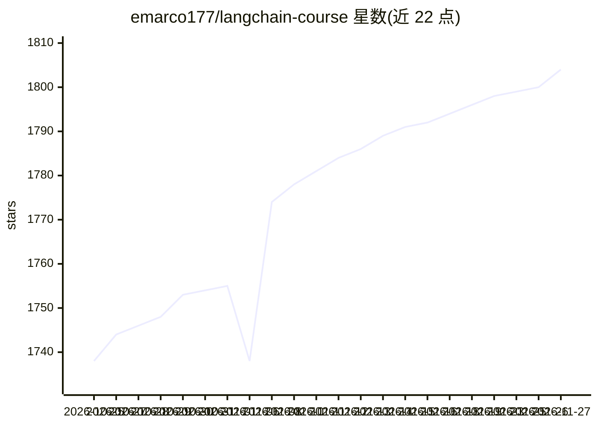

# emarco177/langchain-course

⭐ 1,804 · Apache-2.0 · 推送 2026-11-25 · [GitHub](https://github.com/emarco177/langchain-course) · [官网](https://www.udemy.com/course/langchain/) · 个人维护

**用 LangChain/LangGraph 构建 AI Agent 的实战课程仓库**

以项目驱动的课程代码仓库，通过 7 个按分支组织的 Agent 项目（hello-world、search-agent、rag-gist、system-one-models 等）及若干外部仓库项目（Ice Breaker、Reflection Agent、Agentic RAG）教授 LangChain v1+ 与 LangGraph 的使用。按 commits 顺序跟踪学习进度，技术栈覆盖 Tavily、Pinecone、FAISS、Streamlit。前置要求 Python 3.10+ 与软件工程基础，明确声明非零基础课程。

## 筛选速览

| 维度 | 判定 | 备注 |
|---|---|---|
| AI 角色 | `ai-knowledge` | 知识聚合/清单类 |
| 许可风险 | `permissive` | Apache-2.0 |
| 部署形态 | `None` |  |
| 模型依赖 | — | README 未给出锁定关系 |
| 硬件要求 | — | 无带数字的原话,不猜 |
| 安装摩擦 | `low` | 无编译、无系统依赖或容器化 |
| 成熟度 | — | 结构信号不足 |

## 能力要点

- 7 个项目按 git 分支组织，每条 commit 对应一节课
- 覆盖 create_agent、工具调用、结构化输出、RAG 与反思型 Agent
- 技术栈包括 LangChain v1+、LangGraph、Tavily、Pinecone、FAISS、Streamlit
- LLM 访问支持开源本地（Ollama）或云服务（OpenAI/Anthropic/Gemini）

## 适用场景

- 按分支和 commits 循序渐进学习 LangChain Agent 开发
- 克隆外部项目仓库练习 RAG 与反思型 Agent 的实现
- 为构建检索增强和工具调用型应用积累实操代码

## 场景标签

`教程课程` · 领域:学习与行业

## 证据(README 行号)

> L3: **Learn LangChain and LangGraph by building real world AI Agents (Python, Latest Version V.1.0+)**
> L17: This course takes you through building 7 real-world AI agent projects, from simple hello-world applications to adva
> L37: - **Interactive Learning** - Follow commits chronologically for step-by-step learning

## 星数曲线

2026-10-25 1,738 → 2026-11-27 1,804（+66）

---
*卡片 v1 · prompt 1.4 · 生成 2026-11-26 · 置信度 high · 依据 README sha `52d47eaf6def` · [字段定义](../../DATASET.md)*
