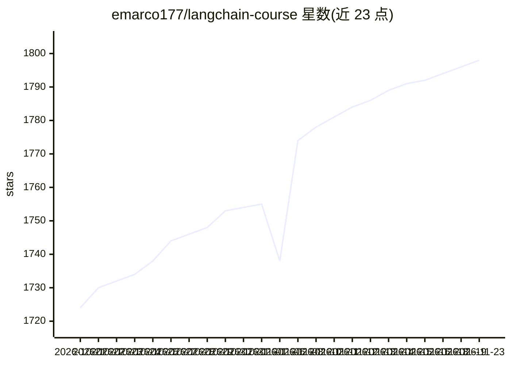

# emarco177/langchain-course

⭐ 1,798 · Apache-2.0 · 推送 2026-11-22 · [GitHub](https://github.com/emarco177/langchain-course) · [官网](https://www.udemy.com/course/langchain/) · 个人维护

**LangChain/LangGraph 开发者的实战课程代码仓库**

配套 Udemy 课程的代码仓库，按分支组织 7 个 AI agent 项目（hello-world、search-agent、rag-gist、code-interpreter 等），另有 Ice Breaker、Reflection Agent 等外部仓库项目。学习路径分基础、实战应用、进阶三阶段，按提交顺序跟学。前置要求 Python 3.10+ 与软件工程基础，明确声明不适合零基础者，需要访问 LLM（可用 Ollama 或云服务商）。

## 筛选速览

| 维度 | 判定 | 备注 |
|---|---|---|
| AI 角色 | `ai-knowledge` | 知识聚合/清单类 |
| 许可风险 | `permissive` | Apache-2.0 |
| 部署形态 | `None` |  |
| 模型依赖 | — | README 未给出锁定关系 |
| 硬件要求 | — | 无带数字的原话,不猜 |
| 安装摩擦 | `low` | 无编译、无系统依赖或容器化 |
| 成熟度 | — | 结构信号不足 |

## 能力要点

- 7 个实战 agent 项目按 git 分支组织，提交对应课程步骤
- 覆盖 search agent、RAG、reflection/reflexion agent、code interpreter
- 技术栈含 LangChain v1+、LangGraph、Pinecone、FAISS、Streamlit

## 适用场景

- 跟学分阶段构建 LangChain agent 项目
- 按提交历史逐步学习 agent 开发流程
- 为 RAG 与自纠正 agent 项目找参考实现

## 场景标签

`教程课程` `RAG` · 领域:知识与检索

## 证据(README 行号)

> L3: **Learn LangChain and LangGraph by building real world AI Agents (Python, Latest Version V.1.0+)**
> L17: This course takes you through building 7 real-world AI agent projects, from simple hello-world applications to adva

## 星数曲线

2026-10-21 1,724 → 2026-11-23 1,798（+74）

---
*卡片 v1 · prompt 1.4 · 生成 2026-11-23 · 置信度 high · 依据 README sha `0cdac44977f7` · [字段定义](../../DATASET.md)*
