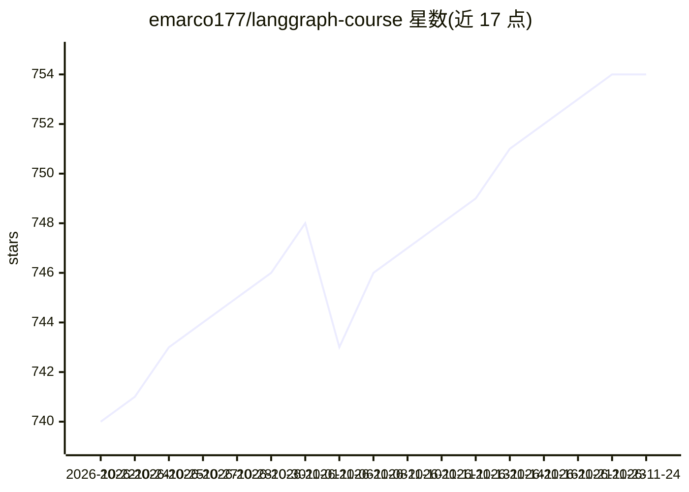

# emarco177/langgraph-course

⭐ 757 · Apache-2.0 · 推送 2026-11-22 · [GitHub](https://github.com/emarco177/langgraph-course) · [官网](https://www.udemy.com/course/langchain/) · 个人维护

**面向开发者的 LangGraph 实战课程配套代码仓库**

Udemy 课程的动手实践配套仓库，以分支为单位组织 6 个 LangGraph 项目（Agentic RAG、ReAct、Reflection、Reflexion 等），以提交为单位对应课程课时，可通过 checkout 分支与回溯提交逐课学习。包含分课时提交索引、.env 环境变量配置（OpenAI/Tavily/LangSmith key）、Discord 社区与课程配套模板仓库。需按课程学习使用，非独立软件。

## 筛选速览

| 维度 | 判定 | 备注 |
|---|---|---|
| AI 角色 | `ai-knowledge` | 知识聚合/清单类 |
| 许可风险 | `permissive` | Apache-2.0 |
| 部署形态 | `None` |  |
| 模型依赖 | — | README 未给出锁定关系 |
| 硬件要求 | — | 无带数字的原话,不猜 |
| 安装摩擦 | `low` | 无编译、无系统依赖或容器化 |
| 成熟度 | — | 结构信号不足 |

## 能力要点

- 每个分支一个项目、每个提交一节课的课程结构
- 覆盖 Agentic RAG、ReAct、Reflection/Reflexion 等工作流实现
- 提交索引表列出各课时对应的 commit hash，可逐课检出

## 适用场景

- 跟学 LangGraph 构建 agent 的实战课程
- 参考 Agentic RAG 的检索打分与自适应路由实现
- 逐提交对比学习 agent 代码的演进过程

## 场景标签

`教程课程` · 领域:学习与行业

## 证据(README 行号)

> L10: > **Build production-grade AI agents—fast.** This repository is the hands-on companion to my Udemy bestseller. Ever
> L33: |#|Commit|Lesson Title|Key Skill|

## 星数曲线

2026-10-22 740 → 2026-11-24 754（+14）

---
*卡片 v1 · prompt 1.4 · 生成 2026-11-24 · 置信度 high · 依据 README sha `5dfe90de6bb3` · [字段定义](../../DATASET.md)*
