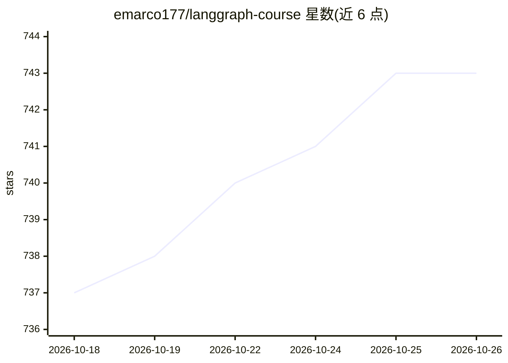

# emarco177/langgraph-course

⭐ 743 · Apache-2.0 · 推送 2026-07-18 · [GitHub](https://github.com/emarco177/langgraph-course) · [官网](https://www.udemy.com/course/langchain/) · 个人维护

**LangGraph 实操课程仓库：分分支分提交学习 LLM agent 开发**

Udemy 课程的配套代码仓库，按分支组织项目、按提交组织课程：agentic-rag（带评分与自适应路由的 RAG 管道）、ReAct agent、reflection/reflexion agent、多步图等 6 个分支项目。Agentic RAG 分支拆为 11 个提交课程，覆盖数据摄取、图状态、检索、文档评分、Tavily 网页搜索、生成、图连线、Self-RAG 与自适应路由。通过 git clone 获取，需配置 OPENAI_API_KEY，Tavily 与 LangSmith 追踪为可选。

## 筛选速览

| 维度 | 判定 | 备注 |
|---|---|---|
| AI 角色 | `ai-knowledge` | 知识聚合/清单类 |
| 许可风险 | `permissive` | Apache-2.0 |
| 部署形态 | `None` |  |
| 模型依赖 | — | README 未给出锁定关系 |
| 硬件要求 | — | 无带数字的原话,不猜 |
| 安装摩擦 | `low` | 无编译、无系统依赖或容器化 |
| 成熟度 | — | 结构信号不足 |

## 能力要点

- 每分支一个项目、每提交一课的代码组织方式
- Agentic RAG 分支 11 节课：从摄取管道到自适应路由
- 涵盖 ReAct、Reflection、Reflexion 三类 agent 模式
- 提供 LangJobs 求职板与 Discord 社区入口

## 适用场景

- 跟随分支与提交逐步学习 LangGraph agent 开发
- 参考 Agentic RAG 管道（评分、网页搜索、自适应路由）的实现
- cherry-pick 或回退提交以实验各个课程步骤

## 场景标签

`教程课程` · 领域:学习与行业

## 证据(README 行号)

> L10: > **Build production-grade AI agents—fast.** This repository is the hands-on companion to my Udemy bestseller. Ever
> L31: ## 📚 Lesson-By-Lesson: *Agentic RAG* Branch

## 星数曲线

2026-10-18 737 → 2026-10-26 743（+6）

---
*卡片 v1 · prompt 1.4 · 生成 2026-10-21 · 置信度 high · 依据 README sha `e16f0eb3c423` · [字段定义](../../DATASET.md)*
