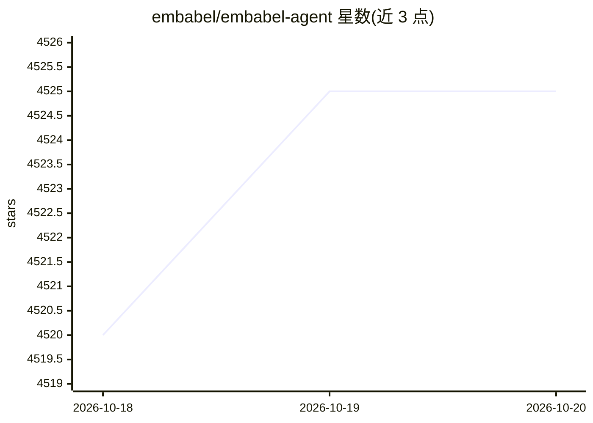

# embabel/embabel-agent

⭐ 4,525 · Kotlin · Apache-2.0 · 推送 2026-10-19 · [GitHub](https://github.com/embabel/embabel-agent) · [官网](https://hub.embabel.com) · 组织维护

**JVM/Kotlin 上的 agentic 流程编排框架，由 Spring 创始人发起**

在 JVM 上编写 agent 流程的 Kotlin 框架（可自然地从 Java 使用），将 LLM 交互与代码、领域模型混合。以 Actions/Goals/Conditions/Domain model/Plan 概念建模，计划由系统动态制定（默认 GOAP，可插拔，另支持 Utility AI），每个动作后重新规划。流程可用类 Spring MVC 注解或 Kotlin DSL 编写，构建于 Spring 之上，支持 Focused/Closed/Open 三种执行模式。需 OPENAI_API_KEY 与 Maven 快速上手，计划支持联邦化。

## 筛选速览

| 维度 | 判定 | 备注 |
|---|---|---|
| AI 角色 | `ai-ecosystem` | LLM/agent 周边工具 |
| 许可风险 | `permissive` | Apache-2.0 |
| 部署形态 | `self-host` | docker 或自建部署 |
| 模型依赖 | local-ok | 支持本地模型 |
| 硬件要求 | — | 无带数字的原话,不猜 |
| 安装摩擦 | `low` | 无编译、无系统依赖或容器化 |
| 成熟度 | `idea` | |

## 能力要点

- 以 Action/Goal/Condition/Domain Model 概念建模 agent 流程
- 默认 GOAP 动态规划，计划步骤可插拔，另支持 Utility AI
- 注解与 Kotlin DSL 两种编写方式，基于 Spring 的强类型领域模型
- Focused/Closed/Open 三种执行模式，Open 模式可组合全部资源构建定制 agent

## 适用场景

- 在 Java/Kotlin 企业应用中构建多 agent 工作流
- 复用 JVM 既有代码与基础设施编写 LLM 混合应用
- 用领域模型强类型定义并单测 agent 逻辑

## 场景标签

`Agent 框架` · 领域:Agent 开发

## 证据(README 行号)

> L30: Embabel (Em-BAY-bel) is a framework for authoring agentic flows on the JVM that seamlessly mix LLM-prompted interac
> L32: intelligent path finding towards goals. Written in Kotlin
> L35: From the creator of Spring.

## 星数曲线

2026-10-18 4,520 → 2026-10-20 4,525（+5）

---
*卡片 v1 · prompt 1.4 · 生成 2026-10-20 · 置信度 mid · 依据 README sha `7e04f180591b` · [字段定义](../../DATASET.md)*
