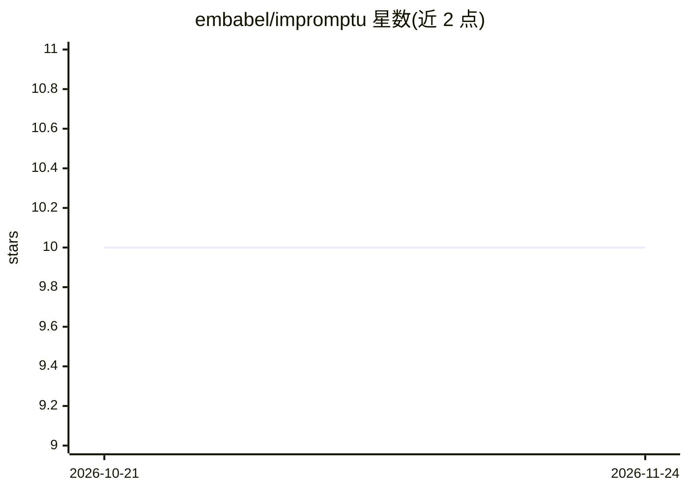

# embabel/impromptu

⭐ 10 · Java · Apache-2.0 · 推送 2026-07-20 · [GitHub](https://github.com/embabel/impromptu) · 组织维护

**基于 Embabel 与 Neo4j 的古典音乐探索聊天机器人**

面向音乐爱好者的古典音乐对话助手，基于 Embabel Agent Framework 与 Neo4j 构建。以 Utility AI 模式让 LLM 自主选择工具，RAG 检索使用 Neo4j 向量存储；通过 Matryoshka Tools 渐进披露 Spotify/IMSLP/Met Museum/YouTube 等工具组；DICE 管线从对话提取语义命题存入图数据库形成用户记忆，并按置信度指数衰减加权召回。LLM 依据领域 schema 约束生成 Cypher 查询，参考数据来自 Open Opus。运行需 Java 21+。

## 筛选速览

| 维度 | 判定 | 备注 |
|---|---|---|
| AI 角色 | `ai-native` | 本体是模型或模型工具 |
| 许可风险 | `permissive` | Apache-2.0 |
| 部署形态 | `self-host` | docker 或自建部署 |
| 模型依赖 | — | README 未给出锁定关系 |
| 硬件要求 | — | 无带数字的原话,不猜 |
| 安装摩擦 | `low` | 无编译、无系统依赖或容器化 |
| 成熟度 | — | 结构信号不足 |

## 能力要点

- Utility AI 模式由 LLM 自主选择 RAG 检索、数据库查询或外部 API 调用
- DICE 命题记忆管线：实体解析分级、命题置信度指数衰减
- schema 约束的 agentic Cypher 查询生成，支持图可视化
- 渐进披露工具组：Spotify 歌单、IMSLP 60万+ 公版乐谱、Met Museum 藏品

## 适用场景

- 用自然语言探索古典乐作曲家、作品与演奏版本
- 通过对话管理 Spotify 歌单与 YouTube 播放
- 自动生成音乐会节目单和聆听指南

## 场景标签

`聊天机器人` `RAG` · 领域:对话与助手

## 证据(README 行号)

> L21: Chatbot intended to help users discover classical music.
> L33: Impromptu is a conversational AI assistant for classical music discovery, powered by the Embabel Agent Framework. I
> L48: Impromptu is built on the Embabel Agent Framework (documentation) using three architectural pillars: **Utility AI**

## 星数曲线

2026-10-21 10 → 2026-11-24 10（+0）

---
*卡片 v1 · prompt 1.4 · 生成 2026-11-19 · 置信度 high · 依据 README sha `2b258352d638` · [字段定义](../../DATASET.md)*
