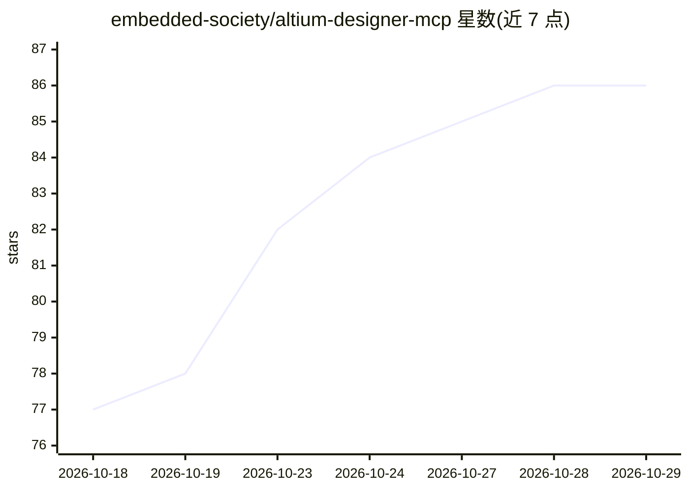

# embedded-society/altium-designer-mcp

⭐ 86 · Rust · GPL-3.0 · 推送 2026-10-27 · [GitHub](https://github.com/embedded-society/altium-designer-mcp) · [官网](https://github.com/embedded-society/altium-designer-mcp) · 组织维护

**让 AI 助手读写 Altium 元件库文件的 MCP 服务器**

面向使用 MCP 客户端（Claude Code、Claude Desktop、Cursor、VS Code Copilot 等）的 Altium Designer 用户的 MCP server：提供 34 个工具，对 .PcbLib 焊盘库与 .SchLib 原理图符号库做读写、比较、原地编辑、库合并、JSON/CSV 导入导出、校验修复与自动备份；AI 负责尺寸计算与布局决策，本工具负责二进制文件 I/O 与图元放置，支持 IPC-7351B 图层约定。以预编译二进制（Linux/macOS/Windows）、Claude Desktop 一键扩展、Docker 容器与 Rust 源码构建四种方式安装；容器模式下挂载目录即全部访问白名单。

## 筛选速览

| 维度 | 判定 | 备注 |
|---|---|---|
| AI 角色 | `ai-ecosystem` | LLM/agent 周边工具 |
| 许可风险 | `viral` | GPL-3.0 |
| 部署形态 | `desktop` | 安装包/桌面程序 |
| 模型依赖 | locked-api |  |
| 硬件要求 | — | 无带数字的原话,不猜 |
| 安装摩擦 | `low` | 无编译、无系统依赖或容器化 |
| 成熟度 | — | 结构信号不足 |

## 能力要点

- 34 个 MCP 工具覆盖 .PcbLib/.SchLib 读写、diff、批量编辑与库管理
- AI 负责工程决策、工具负责未公开 OLE 二进制格式的文件 I/O
- 支持 IPC-7351B 图层与图元（焊盘/过孔/track/圆弧/STEP 3D 模型等）
- 预编译二进制、Claude Desktop 扩展、Docker、源码构建四种分发方式

## 适用场景

- 让 Claude/Cursor 等 AI 助手按数据手册自动生成任意封装与符号
- 批量维护、合并、重命名与导出现有 Altium 元件库
- 在 CI 或 NAS 容器中自动生成库文件而无需安装 Altium

## 场景标签

 · 领域:电子设计自动化（EDA）/工具

## 证据(README 行号)

> L9: An MCP server that gives AI assistants (Claude Code, Claude Desktop, Cursor, Antigravity, VS Code Copilot — any MCP 
> L77: The server exposes **34 tools**, working on both `.PcbLib` (footprints) and

## 星数曲线

2026-10-18 77 → 2026-10-29 86（+9）

---
*卡片 v1 · prompt 1.4 · 生成 2026-10-24 · 置信度 high · 依据 README sha `43c47b8653d5` · [字段定义](../../DATASET.md)*
