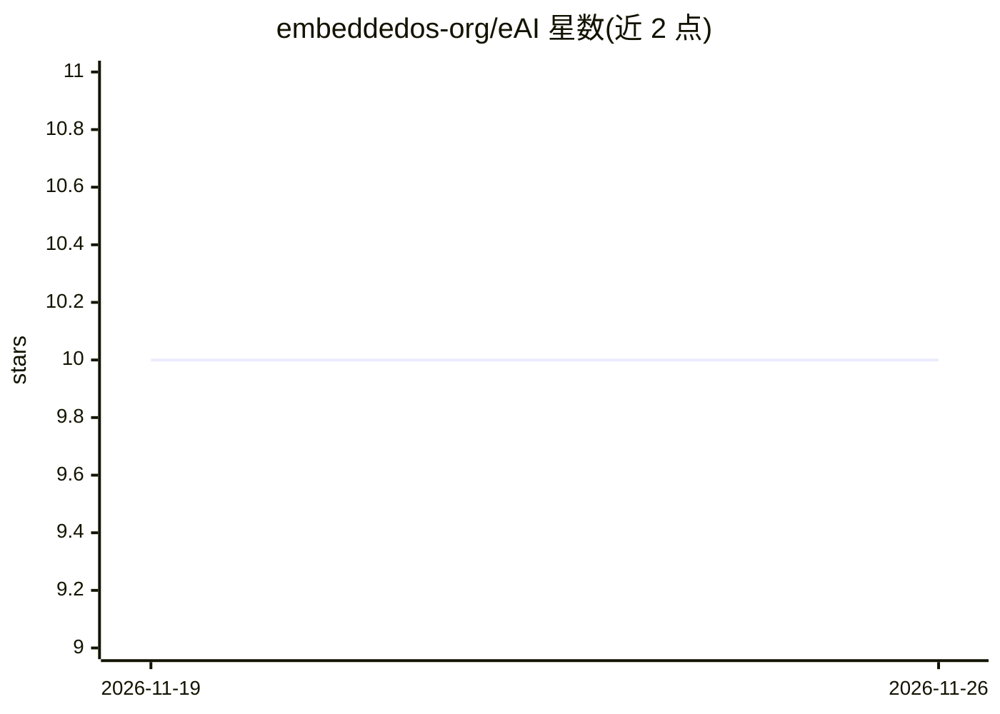

# embeddedos-org/eAI

⭐ 10 · C · MIT · 推送 2026-11-25 · [GitHub](https://github.com/embeddedos-org/eAI) · 组织维护

**嵌入式设备的端侧 AI 运行时层，供 IoT/工业系统集成**

eAI 是 EmbeddedOS 生态的端侧 AI 层，C 语言编写，提供模型加载与运行的运行时契约，含两个可选构建的运行时：面向 IoT 设备的轻量 agent 运行时 EAI-Min（agent loop、router、KV memory）与面向工业系统的 EAI-Framework。另含模型格式加载器、可选硬件加速后端、脑机接口模块、CLI 及 C++/Python 绑定，平台适配覆盖 Linux、Windows、macOS、Android、iOS、Zephyr、FreeRTOS、裸机等。通过 CMake 构建，需 CMake ≥ 3.16 和 C 编译器。

## 筛选速览

| 维度 | 判定 | 备注 |
|---|---|---|
| AI 角色 | `ai-ecosystem` | LLM/agent 周边工具 |
| 许可风险 | `permissive` | MIT |
| 部署形态 | `None` |  |
| 模型依赖 | — | README 未给出锁定关系 |
| 硬件要求 | — | 无带数字的原话,不猜 |
| 安装摩擦 | `medium` | 含编译或系统依赖之一 |
| 成熟度 | — | 结构信号不足 |

## 能力要点

- 提供模型加载与运行的运行时契约及模型格式加载器
- EAI-Min 轻量 agent 运行时（agent loop、router、KV memory）
- 可选加速后端：Vulkan Compute、CoreML/Metal、Qualcomm QNN
- 多平台适配（Linux/Windows/macOS/Android/iOS/Zephyr/FreeRTOS/裸机等）与 C++/Python 绑定

## 适用场景

- 为 IoT 设备构建轻量端侧 agent 运行时
- 在工业网关等嵌入式系统中集成模型推理层
- 通过 CLI 与绑定在多平台上加载运行模型

## 场景标签

`Agent 框架` `推理引擎` · 领域:Agent 开发

## 证据(README 行号)

> L10: written in C. It provides a runtime contract for loading and running models plus
> L11: several build-selectable runtimes: **EAI-Min**, a lightweight agent runtime for

## 星数曲线

2026-11-19 10 → 2026-11-26 10（+0）

---
*卡片 v1 · prompt 1.4 · 生成 2026-11-19 · 置信度 mid · 依据 README sha `26d47a518439` · [字段定义](../../DATASET.md)*
