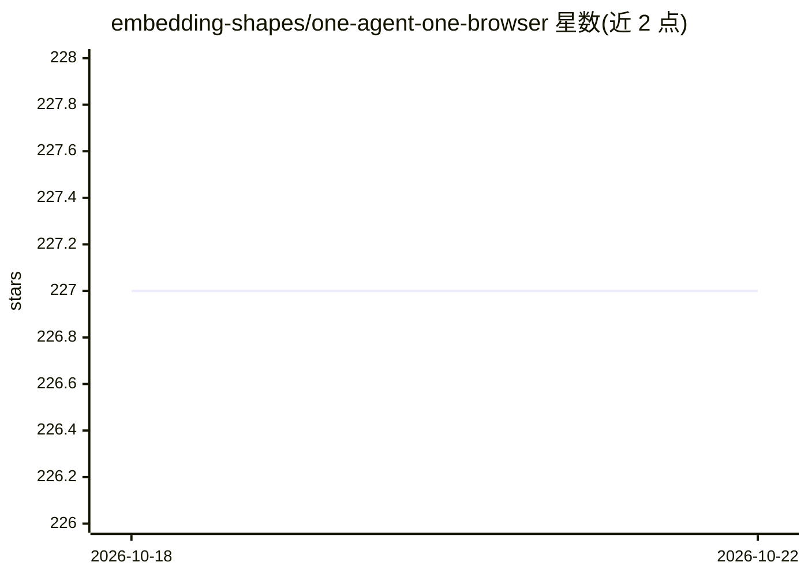

# embedding-shapes/one-agent-one-browser

⭐ 227 · Rust · 推送 2026-01-27 · [GitHub](https://github.com/embedding-shapes/one-agent-one-browser) · [官网](https://emsh.cat/one-human-one-agent-one-browser/) · 个人维护

**由人类与 AI agent 协作从零编写的实验性浏览器**

实验项目：验证 LLM 驱动的 agent 能否在极少人工指导下、不使用第三方库，从零构建一个可运行的浏览器。产品本身是用 Rust 编写的 HTML 渲染器，通过 FFI 调用各平台系统库（Linux 的 X11/Cairo/librsvg 等、Windows 的 WinHTTP/Direct2D、macOS 的 CoreGraphics），可将 .html 文件或 http(s) URL 渲染到屏幕。支持 Linux/X11、Windows 10+ 与 macOS，提供截图、无头模式、视口尺寸与 DPI 缩放参数，并带基于截图对比的渲染回归测试。

## 筛选速览

| 维度 | 判定 | 备注 |
|---|---|---|
| AI 角色 | `ai-enhanced` | 去掉 AI 部分产品仍成立 |
| 许可风险 | `none` | — |
| 部署形态 | `None` |  |
| 模型依赖 | — | README 未给出锁定关系 |
| 硬件要求 | — | 无带数字的原话,不猜 |
| 安装摩擦 | `low` | 无编译、无系统依赖或容器化 |
| 成熟度 | `idea` | |

## 能力要点

- 无第三方库，通过 FFI 调用系统库渲染 HTML
- 跨平台：Linux/X11、Windows 10+、macOS 11+
- 支持 --headless 与 --screenshot 输出 PNG
- 基于基线截图相似度对比的渲染回归测试

## 适用场景

- 我想验证 agent 能否独立完成浏览器这样的系统级项目
- 渲染本地 HTML 文件或抓取 URL 并截图
- 在 CI 无显示环境下跑渲染回归测试

## 场景标签

 · 领域:浏览器/图形渲染

## 证据(README 行号)

> L3: This is an experiment to see if an agent using LLMs, could build a functional browser by itself with minimal guidanc
> L7: - A binary that can render a .html file to the display

## 星数曲线

2026-10-18 227 → 2026-10-22 227（+0）

---
*卡片 v1 · prompt 1.4 · 生成 2026-10-22 · 置信度 high · 依据 README sha `c26934c82143` · [字段定义](../../DATASET.md)*
