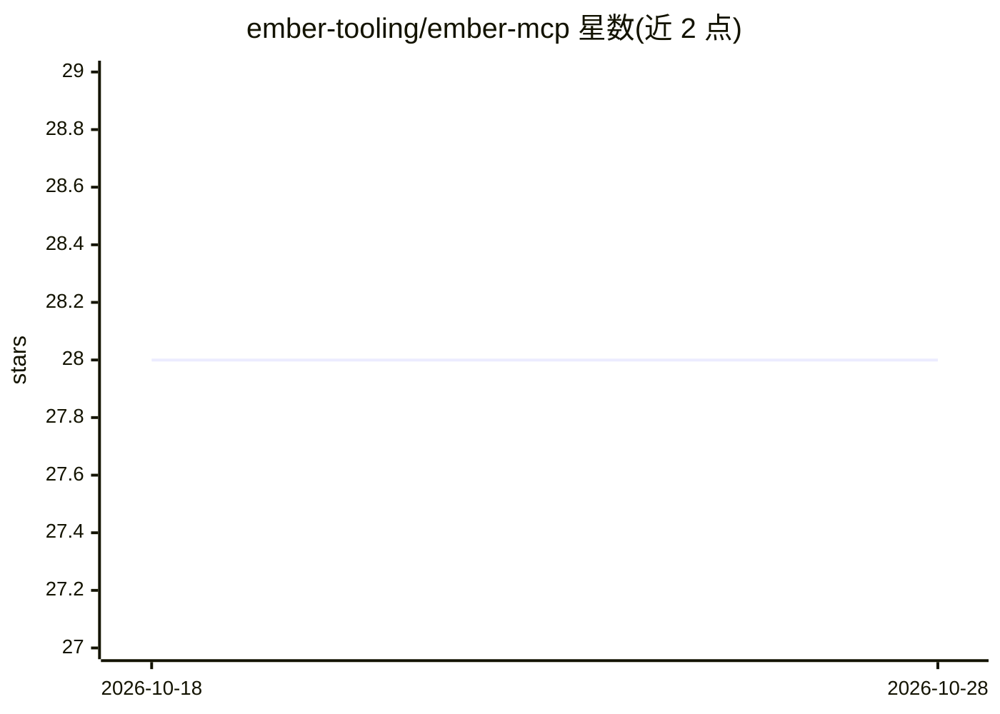

# ember-tooling/ember-mcp

⭐ 28 · JavaScript · MIT · 推送 2026-10-26 · [GitHub](https://github.com/ember-tooling/ember-mcp) · 组织维护

**面向 Ember.js 开发者的 MCP Server：为 AI agent 提供文档与最佳实践访问**

基于 Node.js 的 MCP (Model Context Protocol) 服务器，通过 7 个工具让 AI agent 访问 Ember.js 官方 API 文档、指南、社区文章与最佳实践，并提供 npm 包版本查询、版本对比和包管理器（pnpm/yarn/npm/bun）检测。文档数据在服务器启动时从聚合源拉取并缓存于内存。以 npx 方式在 MCP 客户端配置使用，也可本地克隆运行；README 含免责声明，提示其工具可能被 AI agent 用于有害操作。

## 筛选速览

| 维度 | 判定 | 备注 |
|---|---|---|
| AI 角色 | `ai-ecosystem` | LLM/agent 周边工具 |
| 许可风险 | `permissive` | MIT |
| 部署形态 | `library` | 以包/库形式分发 |
| 模型依赖 | — | README 未给出锁定关系 |
| 硬件要求 | — | 无带数字的原话,不猜 |
| 安装摩擦 | `low` | 无编译、无系统依赖或容器化 |
| 成熟度 | — | 结构信号不足 |

## 能力要点

- 7 个工具：文档搜索、API 参考、最佳实践、版本信息、npm 包信息、版本对比、包管理器检测
- 文档启动时拉取并内存缓存，提供相关性排序的智能搜索
- 通过 npx 在 MCP 客户端（Claude Desktop、VSCode 等）配置运行

## 适用场景

- 让 AI agent 在编码时查询 Ember.js 文档与 API 参考
- Ember 版本升级时获取迁移指南与替代模式
- 确保 agent 使用项目正确的包管理器命令

## 场景标签

 · 领域:Web 前端开发工具/AI agent 基础设施

## 证据(README 行号)

> L3: An MCP (Model Context Protocol) server that provides comprehensive access to Ember documentation, API references, gu
> L29: - Node.js 22 or higher
> L30: - any MCP-compatible client

## 星数曲线

2026-10-18 28 → 2026-10-28 28（+0）

---
*卡片 v1 · prompt 1.4 · 生成 2026-10-26 · 置信度 high · 依据 README sha `a77cc5921849` · [字段定义](../../DATASET.md)*
