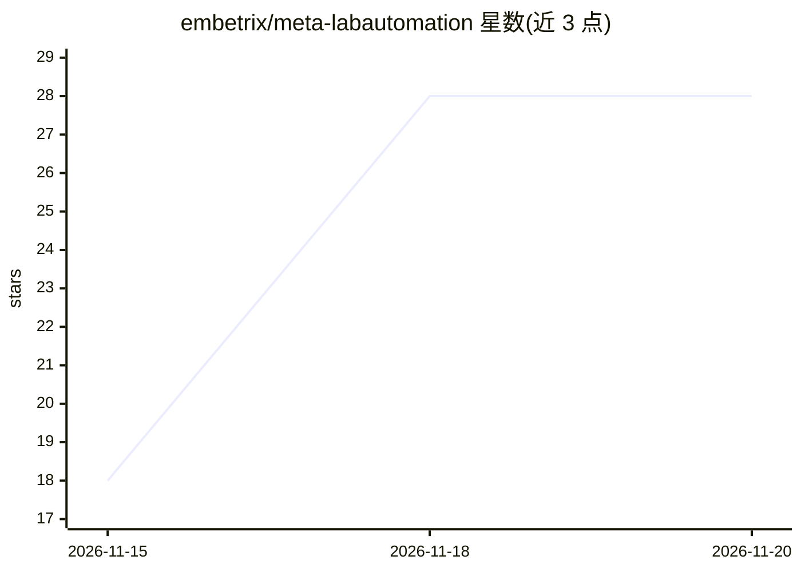

# embetrix/meta-labautomation

⭐ 28 · BitBake · NOASSERTION · 推送 2026-11-14 · [GitHub](https://github.com/embetrix/meta-labautomation) · 组织维护

**构建实验室自动化控制器的 Yocto 层，含 CI/CD 与 AI 代理接入**

OpenEmbedded/Yocto 层，用于构建面向实验室自动化与硬件在环（HIL）测试的 Linux 控制器镜像。镜像内集成板卡烧录与调试工具（UUU、OpenOCD 等）、电源控制、测试仪器控制（PyVISA）、工业协议（CAN/Modbus/MQTT 等）、渗透测试工具、VPN，以及 Jenkins/GitLab/GitHub CI runner 与 Docker。AI 部分为通过 MCP 协议接入 AI 开发与测试代理，实现 AI 辅助实验室自动化。面向嵌入式开发者与测试工程师，使用 kas 构建，支持 QEMU 与树莓派 4/5 等硬件平台。

## 筛选速览

| 维度 | 判定 | 备注 |
|---|---|---|
| AI 角色 | `ai-enhanced` | 去掉 AI 部分产品仍成立 |
| 许可风险 | `permissive` | NOASSERTION |
| 部署形态 | `None` |  |
| 模型依赖 | — | README 未给出锁定关系 |
| 硬件要求 | — | 无带数字的原话,不猜 |
| 安装摩擦 | `low` | 无编译、无系统依赖或容器化 |
| 成熟度 | — | 结构信号不足 |

## 能力要点

- 一条 Yocto 构建产出集成实验室自动化工具链的控制器镜像
- 覆盖烧录/调试、电源控制、仪器控制、工业协议、渗透测试工具集成
- 内置 Jenkins agent、GitLab runner、GitHub Actions runner 与 Docker
- 通过 MCP 协议接入 AI 开发与测试代理

## 适用场景

- 自动化板卡烧录与硬件在环测试
- 搭建带真实硬件的 CI/CD 流水线
- 远程访问与控制实验室设备
- 让 AI 代理通过 MCP 远程操作实验室硬件

## 场景标签

`编码 Agent` `网络安全` · 领域:编码与开发

## 证据(README 行号)

> L7: OpenEmbedded/Yocto layer for building a Linux controller for lab automation and hardware-in-the-loop (HIL) testing.
> L19: Lab automation controller connected to a DUT, remote CI and AI development and test agents through MCP
> L79:  MCP

## 星数曲线

2026-11-15 18 → 2026-11-20 28（+10）

---
*卡片 v1 · prompt 1.4 · 生成 2026-11-18 · 置信度 mid · 依据 README sha `7c2c5b7af99a` · [字段定义](../../DATASET.md)*
