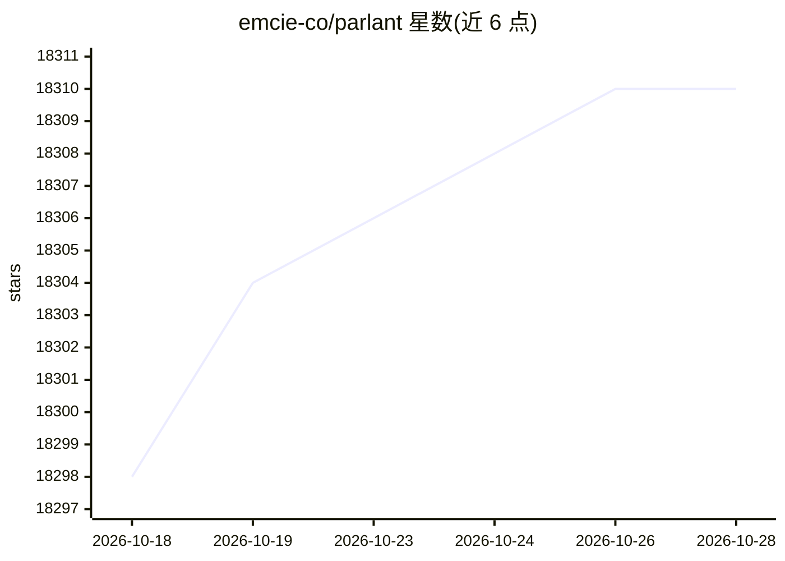

# emcie-co/parlant

⭐ 18,310 · Python · Apache-2.0 · 推送 2026-10-23 · [GitHub](https://github.com/emcie-co/parlant) · [官网](https://www.parlant.io) · 组织维护

**面向企业客服场景的 AI Agent 对话控制框架**

面向客户服务的 Agent 框架，核心机制是按对话轮次动态收窄上下文：开发者以代码定义规则、知识与工具，引擎在每轮匹配仅相关的指令与工具再调用 LLM。提供 Guidelines（条件-动作规则）、Journeys（多轮 SOP）、Canned Responses（预审模板）、工具按需触发与 OpenTelemetry 全链路追踪。通过 pip 安装，提供 Python SDK 与官方 React 聊天组件，Apache 2.0 协议。

## 筛选速览

| 维度 | 判定 | 备注 |
|---|---|---|
| AI 角色 | `ai-native` | 本体是模型或模型工具 |
| 许可风险 | `permissive` | Apache-2.0 |
| 部署形态 | `library` | 以包/库形式分发 |
| 模型依赖 | — | README 未给出锁定关系 |
| 硬件要求 | — | 无带数字的原话,不猜 |
| 安装摩擦 | `low` | 无编译、无系统依赖或容器化 |
| 成熟度 | — | 结构信号不足 |

## 动量与使用信号

- 维护:`maintenance` — 距上次 push 97.5 天,年发版 8,43 位贡献者
- 涨星:近 1 天 **-2**(自 20261016 起算)
- 安装:pypi 包 `parlant` 月下载 5,347

## 能力要点

- 条件-动作式 Guidelines，引擎按轮次匹配相关规则注入上下文
- Journeys 多轮 SOP 流程，支持快进、回退与节奏自适应
- Canned Responses 预审模板限制关键回复用词
- 内置 OpenTelemetry 日志、指标与追踪

## 适用场景

- 搭建需遵守话术与合规要求的客服 Agent
- 在金融、保险、医疗等需要可解释审计的场景部署对话系统
- 管理数百条行为规则而不想让系统提示词超载
- 为现有 LangGraph/LlamaIndex 工作流补充行为控制层

## 场景标签

`Agent 框架` `聊天机器人` · 领域:Agent 开发

## 证据(README 行号)

> L3: ### The interaction control harness for customer-facing AI agents
> L45: Parlant is an agentic harness offering optimized context engineering for conversational use cases: getting the righ

## 星数曲线

2026-10-18 18,298 → 2026-10-28 18,310（+12）

---
*卡片 v1 · prompt 1.4 · 生成 2026-10-18 · 置信度 high · 依据 README sha `455545f738e7` · [字段定义](../../DATASET.md)*
