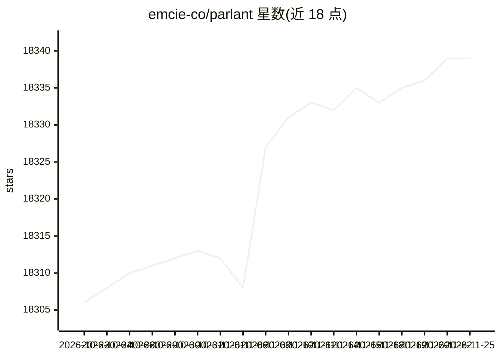

# emcie-co/parlant

⭐ 18,339 · Python · Apache-2.0 · 推送 2026-11-23 · [GitHub](https://github.com/emcie-co/parlant) · [官网](https://www.parlant.io) · 组织维护 · 中文 README

**面向开发者的客户服务 AI agent 构建与运行平台**

开源平台，用于构建和运营面向客户的对话 agent（客服/销售/获客）。核心机制是策略目录：每次对话回合筛选相关策略、流程、工具与固定话术投入模型，带工具调用与回复前置校验、人工接管、模拟测试会话、对话分析与可观测性。通过用户自己的编码 agent（如 Claude Code）驱动搭建，提供 Dashboard 托管与本地自托管两种运行方式，Python 3.10–3.14 环境，pip 安装后经 SDK 编写 agent 行为。

## 筛选速览

| 维度 | 判定 | 备注 |
|---|---|---|
| AI 角色 | `ai-ecosystem` | LLM/agent 周边工具 |
| 许可风险 | `permissive` | Apache-2.0 |
| 部署形态 | `library` | 以包/库形式分发 |
| 模型依赖 | locked-api |  |
| 硬件要求 | — | 无带数字的原话,不猜 |
| 安装摩擦 | `low` | 无编译、无系统依赖或容器化 |
| 成熟度 | — | 结构信号不足 |

## 动量与使用信号

- 维护:`maintenance` — 距上次 push 97.5 天,年发版 8,43 位贡献者
- 涨星:近 1 天 **-2**(自 20261016 起算)
- 安装:pypi 包 `parlant` 月下载 5,347

## 能力要点

- 按回合筛选策略/流程/工具/固定话术的编排机制
- 工具与回复的前置校验及人工接管
- 支持 OpenAI、Anthropic、Gemini、LiteLLM 及自定义 provider
- 模拟测试会话、对话分析与回复到策略的链路追踪

## 适用场景

- 为网站或应用搭建自动客服 agent
- 搭建产品问答与线索收集的销售 agent
- 需要 agent 严格遵循企业策略的客户对话场景

## 场景标签

`聊天机器人` `Agent 框架` · 领域:Agent 开发

## 证据(README 行号)

> L46: **Parlant** is the open platform for building CX agents with AI. It comes with all the parts every customer-facing 
> L129: Most AI frameworks, and the code a coding agent writes on top of them, are built for that left column: for assista

## 星数曲线

2026-10-23 18,306 → 2026-11-25 18,339（+33）

---
*卡片 v1 · prompt 1.4 · 生成 2026-11-23 · 置信度 high · 依据 README sha `d6d455b9bc3d` · [字段定义](../../DATASET.md)*
