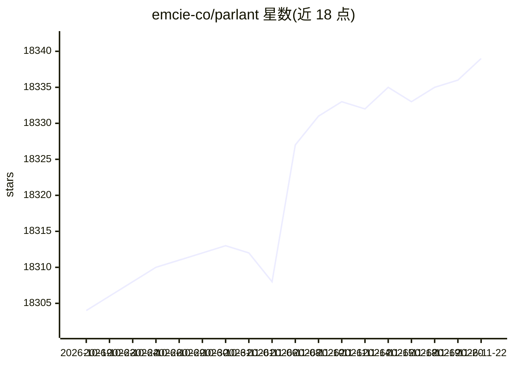

# emcie-co/parlant

⭐ 18,339 · Python · Apache-2.0 · 推送 2026-11-19 · [GitHub](https://github.com/emcie-co/parlant) · [官网](https://www.parlant.io) · 组织维护 · 中文 README

**用自然语言描述行为、由编码 agent 实现的客户对话 agent 构建平台**

Parlant 提供构建面向客户对话 agent 的开源平台：用户以自然语言描述策略与行为，由 Claude Code 等编码 agent 在其代码库上实现。内置策略与流程编目、按对话相关性动态选取规则、工具与回复的执行前校验、标准话术库、聊天组件、人工接管、模拟测试对话与分析观测。模型可自选任意 provider 直接付费；框架 Apache 2.0 开源，Dashboard 托管与监控为按月订阅。要求以 Python 服务运行，agent 行为代码以 Python 编写。

## 筛选速览

| 维度 | 判定 | 备注 |
|---|---|---|
| AI 角色 | `ai-ecosystem` | LLM/agent 周边工具 |
| 许可风险 | `permissive` | Apache-2.0 |
| 部署形态 | `library` | 以包/库形式分发 |
| 模型依赖 | — | README 未给出锁定关系 |
| 硬件要求 | — | 无带数字的原话,不猜 |
| 安装摩擦 | `low` | 无编译、无系统依赖或容器化 |
| 成熟度 | — | 结构信号不足 |

## 动量与使用信号

- 维护:`maintenance` — 距上次 push 97.5 天,年发版 8,43 位贡献者
- 涨星:近 1 天 **-2**(自 20261016 起算)
- 安装:pypi 包 `parlant` 月下载 5,347

## 能力要点

- 策略/流程/工具/话术编目，按轮次动态注入相关性规则
- 工具调用与回复发送前的校验机制（如退款先检查）
- 聊天组件、人工接管、模拟测试、分析观测开箱即用
- 支持 OpenAI、Anthropic、Gemini、LiteLLM 及自定义 provider，无推理加价

## 适用场景

- 给公司网站建一个介绍业务、捕获销售线索并预约会议的 agent
- 在应用内、邮件等渠道自动化客户支持并保持符合业务政策
- 让编码 agent 在几分钟内按 FAQ 新增产品规则并跑模拟对话测试

## 场景标签

`聊天机器人` `Agent 框架` · 领域:Agent 开发

## 证据(README 行号)

> L46: **Parlant** is the open platform for building CX agents with AI. It comes with all the parts every customer-facing 
> L125: Most AI frameworks, and the code a coding agent writes on top of them, are built for that left column: for assista
> L108: For a full project, run `parlant init my-agent --scaffold retail-store` (a working support agent), `--scaffold lea

## 星数曲线

2026-10-19 18,304 → 2026-11-22 18,339（+35）

---
*卡片 v1 · prompt 1.4 · 生成 2026-11-22 · 置信度 high · 依据 README sha `bcb822beedb7` · [字段定义](../../DATASET.md)*
