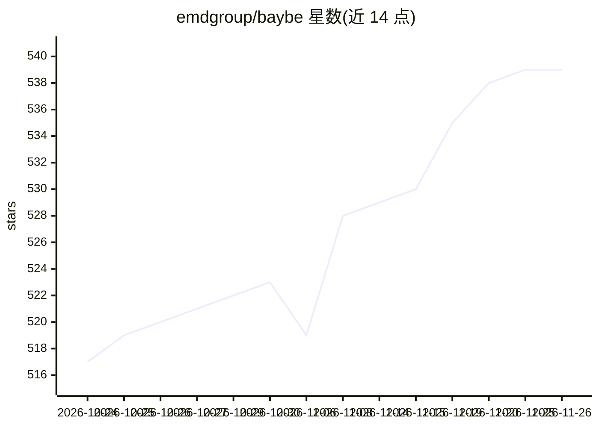

# emdgroup/baybe

⭐ 539 · Python · Apache-2.0 · 推送 2026-11-25 · [GitHub](https://github.com/emdgroup/baybe) · [官网](https://emdgroup.github.io/baybe/) · 组织维护

**科研与工程人员的贝叶斯实验设计（DOE）工具箱**

BayBE 是一个用于贝叶斯实验设计（Design of Experiments）的 Python 工具箱：用户定义参数搜索空间与优化目标，系统基于已有测量数据推荐下一组待测参数配置，通过主动学习在开发与探索之间平衡，逐步逼近目标值。支持连续/离散混合参数、约束条件、多目标优化（Pareto/Desirability）、迁移学习、化学编码（SMILES 指纹）、异步实验与回测评估。通过 pip 从 PyPI、GitHub 或本地克隆安装，另有多组可选依赖（chem/simulation/benchmarking 等）。适用于工业与学术界的真实实验优化场景。

## 筛选速览

| 维度 | 判定 | 备注 |
|---|---|---|
| AI 角色 | `ai-native` | 本体是模型或模型工具 |
| 许可风险 | `permissive` | Apache-2.0 |
| 部署形态 | `library` | 以包/库形式分发 |
| 模型依赖 | — | README 未给出锁定关系 |
| 硬件要求 | — | 无带数字的原话,不猜 |
| 安装摩擦 | `low` | 无编译、无系统依赖或容器化 |
| 成熟度 | — | 结构信号不足 |

## 能力要点

- 混合搜索空间：连续与离散参数可在同一搜索空间中使用
- 多目标优化：支持 Pareto 优化与 Desirability 标量化
- 化学编码：可直接从 SMILES 计算分子指纹用于化学参数
- 主动学习推荐循环：recommend → add_measurements 迭代推进

## 适用场景

- 优化化学反应条件或工艺参数
- 为材料、混合物或配方寻找满足目标性质的配置
- 对物理对象的三维形状做参数化优化
- 进行机器学习模型超参数选择

## 场景标签

`科研工具` · 领域:学习与行业

## 证据(README 行号)

> L24: The **Bay**esian **B**ack **E**nd (**BayBE**) helps to find **good parameter configurations**
> L38: This is achieved via **Bayesian Design of Experiments**,
> L44: BayBE provides a **general-purpose toolbox** for Bayesian Design of Experiments,

## 星数曲线

2026-10-24 517 → 2026-11-26 539（+22）

---
*卡片 v1 · prompt 1.4 · 生成 2026-11-25 · 置信度 high · 依据 README sha `5725ba48c74b` · [字段定义](../../DATASET.md)*
