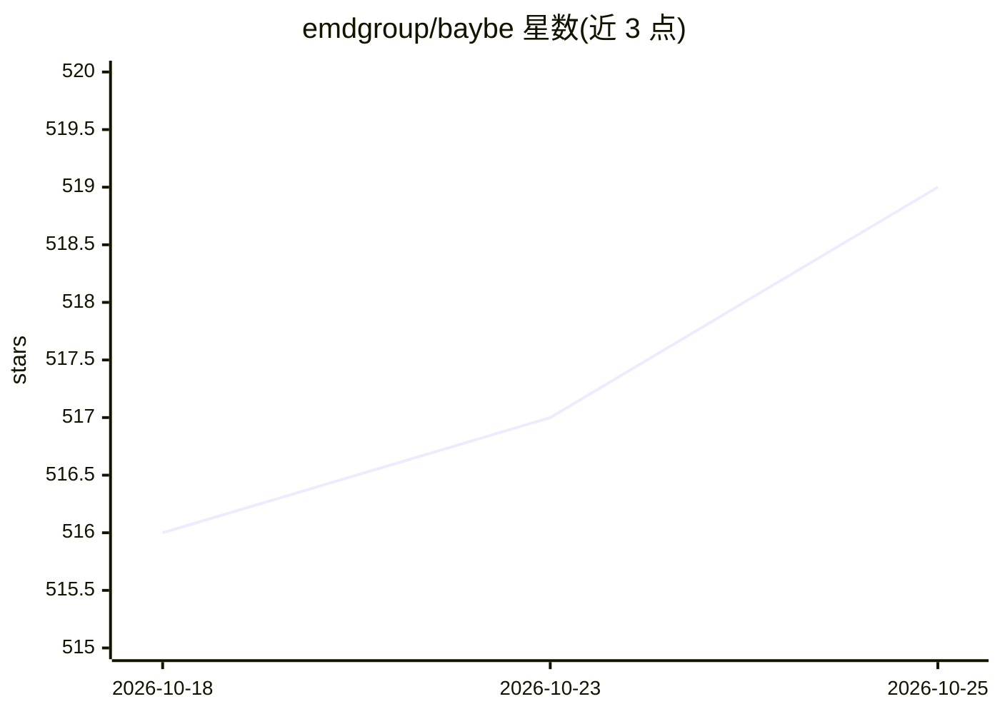

# emdgroup/baybe

⭐ 520 · Python · Apache-2.0 · 推送 2026-10-23 · [GitHub](https://github.com/emdgroup/baybe) · [官网](https://emdgroup.github.io/baybe/) · 组织维护

**面向实验人员的贝叶斯实验设计与优化 Python 工具箱**

BayBE 是由 EMD Group（Merck KGaA）维护的开源 Python 库，通过贝叶斯实验设计帮助用户在复杂参数搜索空间中寻找好的参数配置。用户定义参数搜索空间与优化目标后，库推荐下一批待测参数配置，并将测量结果加入循环迭代。支持连续/离散混合参数、约束、多目标 Pareto 优化、化学分子编码（SMILES/指纹）、迁移学习与异步实验等特性。适用场景包括化学反应条件筛选、材料配方设计、仿真与超参数优化。0.14.0 起已完全移除遥测。

## 筛选速览

| 维度 | 判定 | 备注 |
|---|---|---|
| AI 角色 | `ai-native` | 本体是模型或模型工具 |
| 许可风险 | `permissive` | Apache-2.0 |
| 部署形态 | `library` | 以包/库形式分发 |
| 模型依赖 | — | README 未给出锁定关系 |
| 硬件要求 | — | 无带数字的原话,不猜 |
| 安装摩擦 | `low` | 无编译、无系统依赖或容器化 |
| 成熟度 | — | 结构信号不足 |

## 能力要点

- 推荐下一批实验配置并循环加入测量结果的闭环优化
- 支持连续/离散混合参数、约束与多目标（Pareto/期望函数）优化
- 内置化学编码（如 MORDRED 指纹）与 SubstanceParameter
- 支持异步实验、序列化、迁移学习与基于回测的基准评估

## 适用场景

- 我需要用更少的实验次数找到化学反应的最优条件
- 我需要优化配方、材料或仿真中的参数组合
- 我需要对模型超参数或设备设置做高效搜索

## 场景标签

 · 领域:科学计算/实验优化

## 证据(README 行号)

> L38: This is achieved via **Bayesian Design of Experiments**,
> L44: BayBE provides a **general-purpose toolbox** for Bayesian Design of Experiments,
> L83: BayBE will **recommend the next set of parameter configurations** to be **measured**.

## 星数曲线

2026-10-18 516 → 2026-10-25 519（+3）

---
*卡片 v1 · prompt 1.4 · 生成 2026-10-21 · 置信度 high · 依据 README sha `4c0819a4c754` · [字段定义](../../DATASET.md)*
