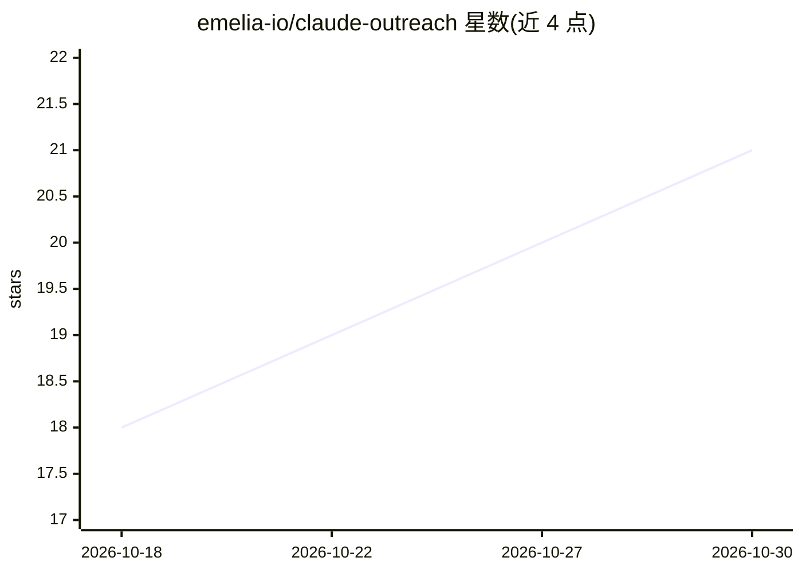

# emelia-io/claude-outreach

⭐ 21 · Python · MIT · 推送 2026-10-21 · [GitHub](https://github.com/emelia-io/claude-outreach) · [官网](https://emelia.io) · 组织维护

**在 Claude Code 内运行 B2B 外联全流程的技能与代理包**

面向创始人、SDR、增长团队与代理商的 Claude Code 插件：以 17 个子技能与 5 个子代理覆盖 ICP 定向、名单构建、邮箱与手机号查找验证、文案撰写、序列设计、送达性检查、活动启动、回复分拣与效果审计。数据富化与发送经 Emelia（MCP 或 REST API），法国 B2B 数据可选 Basile；无任何 key 时以 dry run 运行，产出文件不发信不扣费。每个技能为单个 Markdown 文件，按需加载，文件保留在本机。MIT 许可。

## 筛选速览

| 维度 | 判定 | 备注 |
|---|---|---|
| AI 角色 | `ai-native` | 本体是模型或模型工具 |
| 许可风险 | `permissive` | MIT |
| 部署形态 | `None` |  |
| 模型依赖 | — | README 未给出锁定关系 |
| 硬件要求 | — | 无带数字的原话,不猜 |
| 安装摩擦 | `low` | 无编译、无系统依赖或容器化 |
| 成熟度 | — | 结构信号不足 |

## 能力要点

- 17 个子技能 + 5 个子代理覆盖外联全流程
- 连接 Emelia MCP 服务器或 REST API 完成富化与发送
- 无 key 时全流程 dry run，仅产出文件不发送
- 送达性作为启动门槛（SPF/DKIM/DMARC/预热检查，未通过则阻止启动）

## 适用场景

- 在 Claude Code 里一句话描述目标客户并跑通完整外联活动
- 清洗并验证已购名单，找出仍可用的行再花积分富化
- 审计邮件进垃圾箱的原因并获取递增发送计划

## 场景标签

`AI 写作` · 领域:内容生成

## 证据(README 行号)

> L3: **Run your whole outbound from Claude Code.** Define who you are targeting, build the
> L8: 17 sub-skills, 5 sub-agents, MIT licensed, no lock-in. Bring your own data or source
> L144: |`/outreach personalize <list>`|Icebreakers and AI variables per contact|

## 星数曲线

2026-10-18 18 → 2026-10-30 21（+3）

---
*卡片 v1 · prompt 1.4 · 生成 2026-10-28 · 置信度 high · 依据 README sha `5b9e420fcffa` · [字段定义](../../DATASET.md)*
