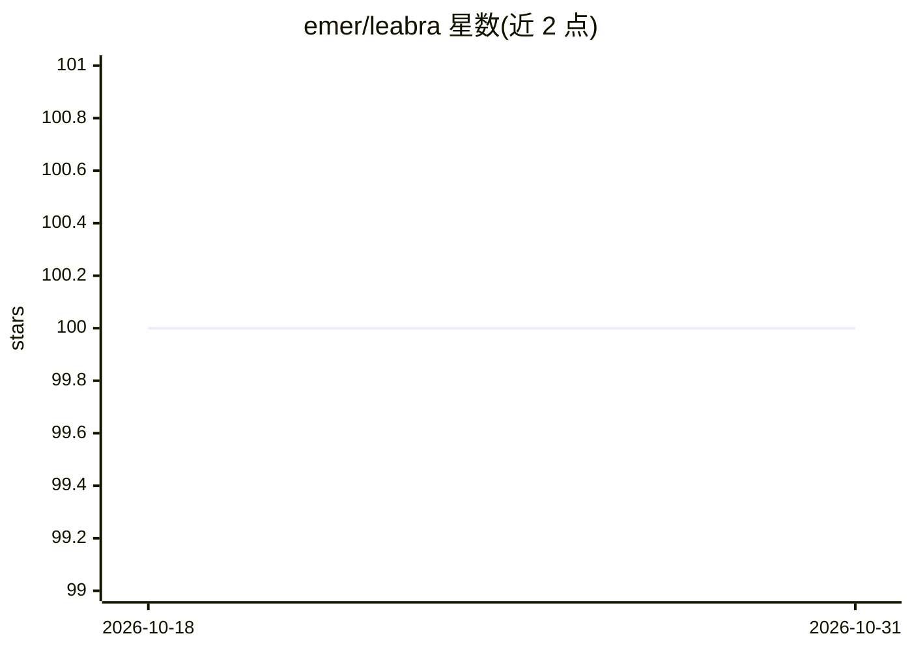

# emer/leabra

⭐ 100 · Go · BSD-3-Clause · 推送 2026-06-29 · [GitHub](https://github.com/emer/leabra) · [官网](https://emersim.org) · 个人维护

**Leabra 认知神经计算算法的 Go 实现，供生物合理性神经网络建模**

Leabra（Local, Error-driven and Associative, Biologically Realistic Algorithm）算法的 Go 语言实现，基于 emergent 框架，面向计算认知神经科学的建模研究。核心机制包括生物合理的点神经元激活函数、FFFB 抑制产生的 kWTA 稀疏分布式表征、以及类 BCM 的 XCAL 学习规则（结合 Hebbian 联想学习与误差驱动学习）；并提供 Deep、Hip、PBWM、RL 等扩展层/通路类型。提供 Python 接口，可经 Cogent Core 在桌面、浏览器、Android/iOS 运行仿真。注意：算法已冻结，研究用户被建议迁移至 axon 框架。

## 筛选速览

| 维度 | 判定 | 备注 |
|---|---|---|
| AI 角色 | `ai-native` | 本体是模型或模型工具 |
| 许可风险 | `permissive` | BSD-3-Clause |
| 部署形态 | `None` |  |
| 模型依赖 | — | README 未给出锁定关系 |
| 硬件要求 | — | 无带数字的原话,不猜 |
| 安装摩擦 | `low` | 无编译、无系统依赖或容器化 |
| 成熟度 | — | 结构信号不足 |

## 能力要点

- 结合误差驱动与 Hebbian 联想学习的 XCAL 学习规则
- FFFB 抑制产生 kWTA 稀疏分布式表征，含 AdEx 离散脉冲模式的近似
- Deep/Hip/PBWM/RL 等扩展以专用 Layer/Path 类型实现
- 提供 Python 接口与 ra25 示例，可运行于 web 浏览器

## 适用场景

- 构建计算认知神经科学的生物合理神经网络模型
- 基于 CCN 教材中的 26 个仿真模型开展学习与研究
- 对比生物合理性神经网络与 PyTorch 反向传播网络

## 场景标签

`科研工具` · 领域:学习与行业

## 证据(README 行号)

> L9: This is the Go implementation of the Leabra algorithm for biologically based models of cognition, based on the emerg
> L51: Leabra stands for *Local, Error-driven and Associative, Biologically Realistic Algorithm*, and it implements a bala

## 星数曲线

2026-10-18 100 → 2026-10-31 100（+0）

---
*卡片 v1 · prompt 1.4 · 生成 2026-10-23 · 置信度 high · 依据 README sha `eed7e7cbbc8e` · [字段定义](../../DATASET.md)*
